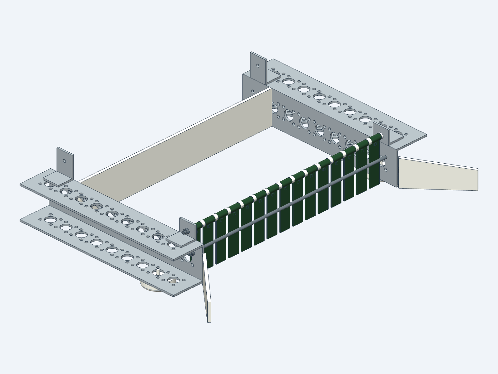
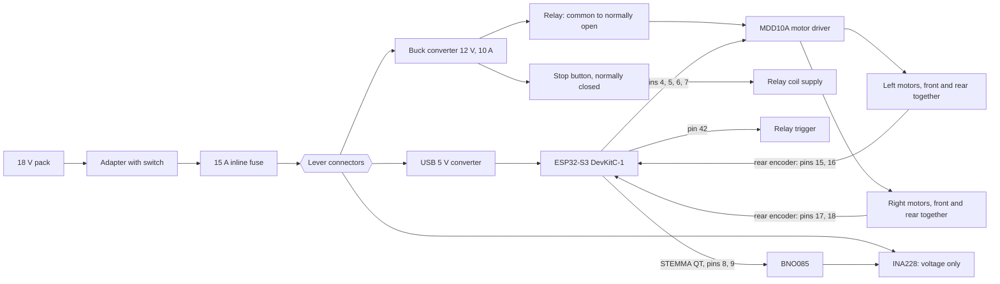

# Building Mulligan

How to build the robot in [DESIGN.md](DESIGN.md) if you have never built anything and own no tools. Every part is bought. Nothing is welded, machined, 3D-printed, drilled or soldered. The only cutting is plastic sheet with a craft knife and two threaded rods with a hacksaw.

The first build is a private proof of concept: tested at home and on a field by the builder, with no children and no public demos. It doesn't need to survive a golf ball yet, so the shell is cheap plastic sheet.

## How it goes together

- **The metal is goBILDA.** goBILDA sells aluminium channel, plates, motors and wheels for school robotics teams. Every part already has holes in the same pattern, so parts bolt together with M4 screws, nuts and a hex key.
- **The panels are corrugated plastic sign board**, called Corflute. It is cut with a craft knife and fixed with cable ties.
- **The electronics are boards with screw terminals and plug-in leads.** Wires join with lever connectors, and boards stick down with hook-and-loop tape or tie through the floor plate's holes.

The numbers come from [design/params.mjs](design/params.mjs), and the plastic panel sizes are in [design/calcs.md](design/calcs.md#panels-to-cut). The 3D model in [cad/](cad/README.md) shows where every part goes.

## Where to buy it in Sydney

| Shop | What from it | How |
| --- | --- | --- |
| [Core Electronics](https://core-electronics.com.au) | All the goBILDA parts, the controller, motor driver and sensors | Online, from Newcastle. Most goBILDA parts are in stock, but some show a lead time of a week or two, so check each page before relying on a date. |
| [Jaycar](https://www.jaycar.com.au) | Stop button, wire, fuses, multimeter, wire stripper | Stores all over Sydney, or online |
| [Bunnings](https://www.bunnings.com.au) | Tools, Corflute, cable ties, hook-and-loop tape, furniture glides, lever connectors, the Ozito battery | Any store |
| Kmart | Flexible chopping mats for the gate flaps | Any store |
| [Phipps Electronics](https://www.phippselectronics.com) | The 12 V power converter | Online, Australian |
| eBay or Amazon Australia | The 30 A relay board and the battery adapter | Online. Pick a seller that ships from Australia. |
| [Schnap](https://www.schnap.com.au) or a bolt shop | M4 threaded rod. Bunnings stores don't reliably stock M4. | Online, or any fastener shop |

## Buy it in three orders

Don't buy everything at once. The pen and gate are the part nobody knows will work, and they cost about a fifth of the whole robot. Build them, push them over balls on grass, and only order the rover if the gate works.

Prices are in Australian dollars, including GST, from the shops' listings in November 2026. A `~` means I couldn't see a listed price and it's an estimate. Shipping is extra. goBILDA's own US prices are about half of Core Electronics', but ordering from the US adds shipping and GST, so compare at checkout for the large second order.

### Order 1: the pen and gate test, about A$310

Tools for this stage, about A$110 at Bunnings:

| Tool | What it is for |
| --- | --- |
| Metric hex key set, including 3 mm | goBILDA's M4 screws |
| 7 mm spanner or nut driver | M4 nuts |
| Junior hacksaw | Two cuts in a threaded rod |
| Craft knife with snap-off blades, 600 mm steel rule, cutting mat | Cutting the plastic panels |
| Bradawl | Poking cable-tie holes in plastic |
| Scissors | Cutting the gate flaps |
| Safety glasses | Everything |

Parts, about A$200:

| Part | Where | Qty | Each, A$ |
| --- | --- | --- | --- |
| 1120 U-channel, 9 holes, 240 mm, for the pen walls (GB-1120-0009-0240) | Core Electronics | 2 | 23.15 |
| 1202 Angle Pattern Mount (1-3), for the pivots and gate rod (GB-1202-0001-0003) | Core Electronics | 4 | 15.20 |
| M4 x 8 mm socket head screws, 25 pack (GB-2800-0004-0008) | Core Electronics | 1 | 5.70 |
| M4 x 12 mm socket head screws, 25 pack (GB-2800-0004-0012) | Core Electronics | 1 | 6.50 |
| M4 nylon-insert locknuts, 25 pack (GB-2812-0004-0007) | Core Electronics | 2 | 4.80 |
| 1502 spacer, 4 mm bore, 6 mm across, 5 mm long, 4 pack | Core Electronics | 5 | ~5 |
| M4 threaded rod, 1 m | Schnap or a bolt shop | 1 | 8.20 |
| 3 mm Corflute, 900 x 600 mm | Bunnings | 2 | ~6 |
| Thin flexible chopping mats | Kmart | 1 pack | ~4 |
| Nylon furniture glides, about 40 mm, with a screw stud or a hole for an M4 bolt | Bunnings | 1 pack | ~6 |
| Cable ties, small and medium | Bunnings | 1 pack each | ~5 |

You'll also need a broom handle and some golf balls.

The second Corflute sheet is a spare for mistakes, and later becomes the shell.

### Order 2: the rover, about A$1,330

Only order this once the gate works on grass.

Tools for this stage, about A$60 at Jaycar:

| Tool | What it is for |
| --- | --- |
| Entry-level multimeter | Setting the 12 V supply and checking wiring before switching on. Do not skip this one. |
| Wire stripper and cutter | Stripping wire ends, cutting the plugs off the motor leads |
| Small flat screwdriver, 2 to 3 mm | Screw terminals on the boards |

goBILDA parts from Core Electronics, about A$825:

| Part | Core Electronics SKU | Qty | Each, A$ |
| --- | --- | --- | --- |
| 5203 Yellow Jacket gearmotor, 26.9:1, 223 rpm, with encoder | GB-5203-2402-0027 | 4 | 94.95 |
| Wasteland Wheel, 144 mm | GB-3616-0014-0144 | 4 | 51.10 |
| 1310 Hyper Hub, 8 mm REX bore | GB-1310-0016-4008 | 4 | 13.50 |
| 1120 U-channel, 18 holes, 456 mm, for the rails | GB-1120-0018-0456 | 2 | 40.05 |
| 1116 grid plate, 232 x 424 mm, for the floor | GB-1116-0232-0424 | 1 | 58.25 |
| M4 x 12 mm socket head screws, 25 pack | GB-2800-0004-0012 | 1 | 6.50 |
| M4 x 30 mm socket head screws, 25 pack | GB-2800-0004-0030 | 1 | ~7 |
| M4 nylon-insert locknuts, 25 pack | GB-2812-0004-0007 | 2 | 4.80 |
| Encoder breakout cable, JST XH to four single sockets [MH-FC], 300 mm | GB-3801-0919-0300 | 2 | ~10 |
| 1502 spacer, 4 mm bore, 10 mm long, 4 pack, for the pen pivots | | 1 | ~5 |

The motors and wheels are A$585 of that. Check the encoder cable's name ends in [MH-FC], meaning sockets that push onto the controller's pins, and not [FH-MC], which ends in pins.

Electronics, about A$365:

| Part | Where | Qty | Each, A$ |
| --- | --- | --- | --- |
| ESP32-S3-DevKitC-1, the controller | Core Electronics | 1 | 59.75 |
| Cytron MDD10A dual motor driver. Its control pins take 3 to 5.5 V, so the controller drives it directly. | Core Electronics | 1 | 41.13 |
| Adafruit BNO085 motion sensor, STEMMA QT (ADA4754) | Core Electronics | 1 | ~47 |
| Adafruit INA228 power monitor, STEMMA QT (ADA5832). Measures the battery voltage only; don't run motor current through it. | Core Electronics | 1 | ~25 |
| STEMMA QT cable to female sockets, 150 mm (ADA4397), and a STEMMA QT cable, 50 mm (ADA4399) | Core Electronics | 1 each | ~2 |
| Female-to-female jumper wires | Core Electronics or Jaycar | 1 pack | ~6 |
| DC-DC 20 A, 300 W adjustable step-down converter with constant current. Takes 6 to 40 V in, so a full 21 V pack is fine. | Phipps Electronics | 1 | 36.95 |
| 12 V, 30 A, 1-channel relay board, opto-isolated, high/low trigger jumper | eBay or Amazon Australia | 1 | ~15 |
| 12 to 24 V to 5 V USB converter with wired input, and a USB-C cable | Jaycar or Amazon Australia | 1 | ~20 |
| Latching emergency stop switch (SP0786). Use its normally closed contact. | Jaycar | 1 | 16.95 |
| Ozito PXC 18 V battery adapter with switch and wire leads | eBay Australia | 1 | ~35 |
| Inline blade fuse holder for 2.5 mm² wire, and 15 A blade fuses | Jaycar | 1 each | ~10 |
| Wago 221 lever connectors, rated 20 A or more, assortment | Bunnings or Jaycar | 1 | ~25 |
| 2.5 mm² wire, red and black, 2 m each | Jaycar | | ~15 |
| Hook-and-loop tape | Bunnings | 1 | ~10 |

The battery, about A$50 to A$100:

An **Ozito PXC 18 V 4.0 Ah battery and charger pack**, from Bunnings. Ozito is the cheapest 18 V tool battery in Australia, and its adapters are easy to find. The price swings between about A$50 and A$100 with Bunnings' specials. A 4 Ah pack gives about 4 hours of driving ([calcs.md](design/calcs.md#power-and-runtime)). If you already own another brand's 18 V tools, use that battery and buy the adapter for it instead.

### Order 3: the shell, about A$25

| Part | Where | Qty | Each, A$ |
| --- | --- | --- | --- |
| Hook-and-loop straps, 25 mm | Bunnings | 2 | ~5 |
| Child's bike safety flag with a two-piece pole, optional for private testing | Kmart or Big W | 1 | ~15 |

The shell itself comes from the spare Corflute sheet in order 1.

### Total

About A$1,650: A$310 for the pen test, then A$1,330 for the rover and A$25 for the shell. More than half of it is goBILDA parts, and the motors and wheels alone are A$585.

## Check before ordering

I designed around the parts' published figures but couldn't confirm all of them. Each check below is quick:

- **Angle mount hole heights.** The pen pivot needs a hole in the bracket's upright about 20 mm above the pen wall, and the gate rod one about 8 mm above. Look at the drawing on goBILDA's page for the 1202 mount before order 1. If its holes are elsewhere, choose another goBILDA angle mount, or change `pen.hingeZ` and `gate.hingeZ` in `params.mjs` and rerun the drawings.
- **Relay board.** Boards called "30 A relay module" are sold at 10 A too, so check the listing says 30 A. Some don't switch reliably from a 3.3 V pin. Test it on the bench with the controller before fitting it.
- **Battery adapter.** Get the one for your pack's brand and voltage, with a switch. It probably has no fuse, which is why the list has an inline fuse holder.
- **Hub length.** The track of 370 mm assumes the hub and wheel sit about 19 mm out from the rail. Measure once they're on. The shell clears the wheels by 14 mm, so there is some margin.
- **Stock.** Some goBILDA parts at Core Electronics come from a supplier with a week or two's lead time. Check the dispatch date on each page.

## Wiring

- **Grounds.** Every board's ground joins the battery's negative.
- **Fuse.** Put the inline fuse holder in the positive lead straight after the adapter, before anything else.
- **Motors.** Cut the bullet plugs off the motor leads, strip 8 mm, and put each side's front and rear leads into the same driver terminals. The right-hand motors face the other way, so they turn backwards for the same command. Reverse them in the firmware, not by rewiring.
- **Encoders.** They run on the controller's 3.3 V pin, so their signals are safe for its inputs with no level shifter.
- **Stop button.** It breaks the relay coil's supply directly, so it cuts motor power even if the controller has crashed. The controller and sensors stay powered and can report why it stopped. Leave enough slack in its wires for the shell to hinge up.

## Build order

This follows the stages in the [build plan](README.md#build-stages). Each step ends with something you can test.

### 1. The pen and gate (about a day)

This is the hand test from the build plan, made from the real parts. If the gate doesn't work on grass, nothing else matters.

1. Cut the threaded rod into two 330 mm pieces with the hacksaw. Run a nut over each cut end to clean the thread.
2. Lay the two 240 mm channels with their flat face inward and flanges outward, 300 mm apart between the flat faces. Bolt an angle mount on top of each at the first hole, for the pivot, and at the last hole, for the gate rod, with the uprights in line with the flat faces.
3. Cut fifteen 15 x 76 mm strips from the chopping mat. Fold the top 16 mm of each over the threaded rod and push a small cable tie through both layers just below the rod. Leave the loop loose so the flap swings freely.
4. Thread the gate rod through one gate bracket. Add a nut on each side of the bracket, then a spacer, a flap, a spacer and so on across, then the other bracket with a nut on each side. Leave about 1 mm of play in the row so the flaps swing freely.
5. Fit the stop rod through the small holes in the pen walls, 8 mm in front of the gate rod and 24 mm below it, with a nut on each side of each wall. Check that a flap can swing back into the pen but stops against this rod going forward.
6. Cut the back wall (300 x 48 mm) and the two funnel wings from the plastic sheet, using the sizes in [calcs.md](design/calcs.md#panels-to-cut). Cable-tie them to the walls' holes.
7. Bolt a skid under each wall's bottom flange, one hole behind the gate.
8. Cable-tie a broom handle across the two pivot brackets. Push the pen at walking pace over balls on a mat, short grass, long grass, wet grass and a divot. Count how many of twenty go in on each, then try thicker and thinner flaps. Then check retention: with ten balls in, pull it backwards and swing it through a tight turn.

### 2. The rover (R0)

1. Lay the two 456 mm rails 280 mm apart across their outside faces, open sides facing each other. Bolt the grid plate across their bottom flanges, with an M4 x 12 mm screw and locknut at every other hole that lines up.
2. Fit each motor from inside the rail, shaft out through a large hole and the motor face flat against the rail, with four M4 x 8 mm screws through the small holes around it. The rear motors go at the 4th large hole from the back, the front motors at the 5th large hole from the front.
3. Slide a hub onto each motor shaft and bolt a wheel to it. Tighten the hub's clamp screws.
4. Stick the boards to the floor plate: the battery adapter in the middle, the motor driver beside it, and the rest around them. The model in [cad/](cad/README.md) shows one layout that fits between the motors.
5. Wire it as above, with the battery out. Before connecting the motor driver, set the buck converter to 12.0 V with the multimeter, and set its current limit to 10 A following the converter's own instructions.
6. Check every connection with the multimeter, then fit the battery with the wheels off the ground. Test each motor alone before driving.
7. Write the firmware. The control link and safety rules are in the [build plan](README.md#control-link-draft) and [DESIGN.md](DESIGN.md#firmware).

### 3. Pickup on the rover (R1)

Bolt the pen on with an M4 x 30 mm screw at each side. The screw goes from inside the rail out through the small hole above and in front of the rail's front-most large hole, then through a 10 mm spacer and the pivot bracket. Finish with a locknut, snug but not tight, so the pen swings up and down freely.

### 4. Shell, skirts and flag

1. Cut the shell panels and the two end skirts using the sizes in [calcs.md](design/calcs.md#panels-to-cut). The flutes in the shell panels should run up the slope.
2. Join the shell's seams with cable ties through bradawl holes every 40 mm or so, then tape them inside.
3. Cut a 22 mm hole in the rear panel, on its centre line and about 45 mm up the slope from its bottom edge, for the stop button. Fit the button with its ring nut.
4. Cable-tie the shell's front edge loosely to the rails' top flanges so it hinges up, and hold its back edge down with the two hook-and-loop straps. Lift it to swap the battery.
5. Cable-tie the skirts across the ends of the rails.
6. If you're fitting the flag, drop its pole through the left pen wall's flanges at the second hole, and cable-tie it to the wall.

The Corflute shell keeps rain and grass off the electronics and carries the stop button. It is not meant to survive a golf ball. That only matters once the robot goes to a working range, and then the same panel shapes can be cut from 4.5 mm polycarbonate by a plastics cutting service and joined the same way.
