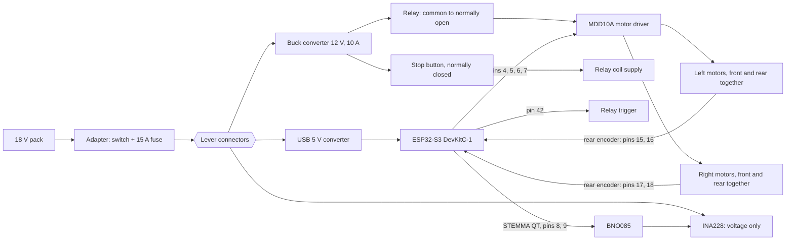

# Building Mulligan

How to build the robot in [DESIGN.md](DESIGN.md) if you have never built anything and own no tools. Every part is bought. Nothing is welded, machined, 3D-printed, drilled or soldered. The only cutting is plastic sheet with a craft knife and two threaded rods with a hacksaw.

## How it goes together

- **The metal is goBILDA.** goBILDA sells aluminium channel, plates, motors and wheels for school robotics teams. Every part already has holes in the same pattern, so parts bolt together with M4 screws, nuts and a hex key. In Australia, Core Electronics stocks it; elsewhere, buy from goBILDA or RobotShop.
- **The panels are corrugated plastic sign board**, called Corflute in Australia, Coroplast in the US and Correx in the UK. It is cut with a craft knife and fixed with cable ties.
- **The electronics are boards with screw terminals and plug-in leads.** Wires join with lever connectors, and boards stick down with hook-and-loop tape or tie through the floor plate's holes.

The numbers come from [design/params.mjs](design/params.mjs), and the plastic panel sizes are in [design/calcs.md](design/calcs.md#panels-to-cut). The 3D model in [cad/](cad/README.md) shows where every part goes.

## Tools to buy

| Tool | What it is for |
| --- | --- |
| 3 mm hex key, a T-handle and an L-shaped one | goBILDA's M4 screws |
| 7 mm spanner or nut driver | M4 nuts |
| Small flat screwdriver, 2 to 3 mm | Screw terminals on the boards |
| Wire stripper and cutter | Stripping wire ends, cutting the plugs off the motor leads |
| Multimeter | Setting the 12 V supply and checking wiring before switching on. Do not skip this one. |
| Craft knife with snap-off blades, 600 mm steel rule, cutting mat | Cutting the plastic panels |
| Junior hacksaw | Two cuts in a threaded rod |
| Bradawl | Poking cable-tie holes in plastic |
| Scissors | Cutting the gate flaps |
| Safety glasses | Everything |

## Shopping list

These are prices I found in November 2026 or typical prices, not quotes. goBILDA's are its US list prices. For comparison, the Hyper Hub is US$7.99 at goBILDA and A$13.50 at Core Electronics.

### goBILDA parts

| Part | goBILDA number | Qty | Each, US$ |
| --- | --- | --- | --- |
| 5203 Yellow Jacket gearmotor, 26.9:1, 223 rpm, with encoder | 5203-2402-0027 | 4 | 54.99 |
| Wasteland Wheel, 144 mm | 3616-0014-0144 | 4 | 24.99 |
| 1310 Hyper Hub, 8 mm REX bore | 1310-0016-4008 | 4 | 7.99 |
| 1120 U-channel, 456 mm, for the rails | 1120-0018-0456 | 2 | 21.99 |
| 1120 U-channel, 240 mm, for the pen walls | 1120-0010-0240 | 2 | 13.99 |
| 1116 grid plate, 232 x 424 mm, for the floor | 1116-0232-0424 | 1 | 29.99 |
| Angle mount for the pen pivots and gate rod, such as the 1202 Angle Pattern Mount | 1202-0001-0003 | 4 | 8.99 |
| M4 socket head screws, 8, 12 and 30 mm | 2800-0004-00xx | a pack of each | |
| M4 nylon-insert locknuts and washers | | a pack of each | |

About US$560 with screws and nuts.

### Electronics

| Part | Qty | Notes |
| --- | --- | --- |
| Espressif ESP32-S3-DevKitC-1 | 1 | The controller. Its pins come fitted, so leads push on. |
| Cytron MDD10A dual motor driver | 1 | Screw terminals for power and motors. Its control pins take 3 to 5.5 V, so the controller drives it directly. |
| Adafruit BNO085 motion sensor, STEMMA QT (#4754) | 1 | Plugs in with no soldering. |
| Adafruit INA228 power monitor, STEMMA QT (#5832) | 1 | Measures the battery voltage. Its screw terminal comes fitted. Don't run motor current through it. |
| STEMMA QT cable to female sockets, 150 mm (#4397), and a STEMMA QT cable, 50 mm (#4399) | 1 each | Controller to the sensors, then sensor to sensor |
| JST-XH 4-pin to female jumper leads | 2 | Rear motor encoders to the controller. The front encoders are spares. |
| Female-to-female jumper wires | 1 pack | Controller to the motor driver |
| CC/CV buck converter, 300 W, 20 A, 6 to 40 V in, with screw terminals | 1 | The 12 V motor supply. Set to 12.0 V and 10 A. |
| 12 V relay module, 1 channel, 30 A, opto-isolated, with screw terminals | 1 | Cuts motor power. |
| 12 to 24 V to 5 V USB converter, wired input, and a USB-C cable | 1 | Powers the controller. |
| 22 mm latching emergency stop button with a normally closed contact | 1 | Goes through the shell. |
| Battery adapter for your tool brand's 18 V pack, with switch and fuse holder | 1 | Fit a 15 A blade fuse in place of the one supplied. |
| 15 A blade fuses | 1 pack | |
| Lever wire connectors, such as Wago 221, rated 20 A or more | 1 assortment | Every power join |
| Wire, 2.5 mm² (about 14 AWG) red and black, 2 m each | | Power |

About US$200.

### Materials and hardware

| Part | Qty | Notes |
| --- | --- | --- |
| 4 mm corrugated plastic sheet, 600 x 900 mm | 1 | Shell, skirts, pen back wall, funnel wings. Pick a red one. |
| Thin flexible polypropylene chopping mats | 1 pack | The gate flaps |
| M4 threaded rod, 1 m | 1 | Cut into two 330 mm pieces for the gate rod and stop rod |
| M4 nylon spacers, 5 mm long | 20 | Between the flaps |
| M4 nylon spacers, 10 mm long | 2 | Pen pivots |
| Nylon furniture glides, about 40 mm, with an M4 threaded stud | 2 | Skids under the pen. If the stud isn't M4, use a flat glide on an M4 bolt. |
| Child's bike safety flag with a two-piece pole | 1 | Use one section. The pole must fit a 14 mm hole. |
| Cable ties, small and medium | 1 pack each | |
| Hook-and-loop tape, and two 25 mm hook-and-loop straps | | Mounting boards; holding the shell's back edge down |

About US$80.

### Battery

An 18 V, 5 Ah power-tool pack and its charger. If you already own cordless tools, use that brand and buy the matching adapter. A second pack lets one charge while the other runs.

### Total

Roughly US$1,000 with tools, plus a battery if you don't have one.

## Check before ordering

I designed around the parts' published figures but couldn't confirm all of them. Each check below is quick:

- **Angle mount hole heights.** The pen pivot needs a hole in the bracket's upright about 20 mm above the pen wall, and the gate rod one about 8 mm above. Look at goBILDA's drawing of the bracket. If its holes are elsewhere, choose another goBILDA angle mount, or change `pen.hingeZ` and `gate.hingeZ` in `params.mjs` and rerun the drawings.
- **Relay trigger.** Some 30 A relay modules don't switch reliably from a 3.3 V pin. Test it on the bench before fitting it, or buy one sold as working from 3.3 V.
- **Buck converter input.** A full 18 V pack is about 21 V. Buy a converter rated for at least 30 V in.
- **Battery adapter.** Get the one for your pack's brand and voltage. Check the fuse holder takes standard blade fuses.
- **Hub length.** The track of 370 mm assumes the hub and wheel sit about 19 mm out from the rail. Measure once they're on. The shell clears the wheels by 14 mm, so there is some margin.

## Wiring

- **Grounds.** Every board's ground joins the battery's negative.
- **Motors.** Cut the bullet plugs off the motor leads, strip 8 mm, and put each side's front and rear leads into the same driver terminals. The right-hand motors face the other way, so they turn backwards for the same command. Reverse them in the firmware, not by rewiring.
- **Encoders.** They run on the controller's 3.3 V pin, so their signals are safe for its inputs with no level shifter.
- **Stop button.** It breaks the relay coil's supply directly, so it cuts motor power even if the controller has crashed. The controller and sensors stay powered and can report why it stopped. Leave enough slack in its wires for the shell to hinge up.

## Build order

This follows the stages in the [build plan](README.md#build-stages). Each step ends with something you can test.

### 1. The pen and gate (about a day)

This is the hand test from the build plan, made from the real parts. If the gate doesn't work on grass, nothing else matters.

1. Cut the threaded rod into two 330 mm pieces with the hacksaw. Run a nut over each cut end to clean the thread.
2. Lay the two 240 mm channels with their flat face inward and flanges outward, 300 mm apart between the flat faces. Bolt an angle mount on top of each at the first hole, for the pivot, and at the last hole, for the gate rod, with the uprights in line with the flat faces.
3. Cut fifteen 15 x 76 mm strips from the chopping mat. Fold the top 16 mm of each over the threaded rod and push a small cable tie through both layers just below the rod. Leave the loop loose so the flap swings freely.
4. Thread the gate rod through one gate bracket. Add a nut on each side of the bracket, then a spacer, a flap, a spacer and so on across, then the other bracket with a nut on each side. Leave about 1 mm of play in the row so the flaps swing freely.
5. Fit the stop rod through the small holes in the pen walls, 8 mm in front of the gate rod and 24 mm below it, with a nut on each side of each wall. Check that a flap can swing back into the pen but stops against this rod going forward.
6. Cut the back wall (300 x 48 mm) and the two funnel wings from the plastic sheet, using the sizes in [calcs.md](design/calcs.md#panels-to-cut). Cable-tie them to the walls' holes.
7. Bolt a skid under each wall's bottom flange, one hole behind the gate.
8. Cable-tie a broom handle across the two pivot brackets. Push the pen at walking pace over balls on a mat, short grass, long grass, wet grass and a divot. Count how many of twenty go in on each, then try thicker and thinner flaps. Then check retention: with ten balls in, pull it backwards and swing it through a tight turn.

### 2. The rover (R0)

1. Lay the two 456 mm rails 280 mm apart across their outside faces, open sides facing each other. Bolt the grid plate across their bottom flanges, with an M4 x 12 mm screw and locknut at every other hole that lines up.
2. Fit each motor from inside the rail, shaft out through a large hole and the motor face flat against the rail, with four M4 x 8 mm screws through the small holes around it. The rear motors go at the 4th large hole from the back, the front motors at the 5th large hole from the front.
3. Slide a hub onto each motor shaft and bolt a wheel to it. Tighten the hub's clamp screws.
4. Stick the boards to the floor plate: the battery adapter in the middle, the motor driver beside it, and the rest around them. The model in [cad/](cad/README.md) shows one layout that fits between the motors.
5. Wire it as above, with the battery out. Before connecting the motor driver, set the buck converter to 12.0 V with the multimeter, and set its current limit to 10 A following the converter's own instructions.
6. Check every connection with the multimeter, then fit the battery with the wheels off the ground. Test each motor alone before driving.
7. Write the firmware. The control link and safety rules are in the [build plan](README.md#control-link-draft) and [DESIGN.md](DESIGN.md#firmware).

### 3. Pickup on the rover (R1)

Bolt the pen on with an M4 x 30 mm screw at each side. The screw goes from inside the rail out through the small hole above and in front of the rail's front-most large hole, then through a 10 mm spacer and the pivot bracket. Finish with a locknut, snug but not tight, so the pen swings up and down freely.

### 4. Shell, skirts and flag (R3)

1. Cut the shell panels and the two end skirts using the sizes in [calcs.md](design/calcs.md#panels-to-cut). The flutes in the shell panels should run up the slope.
2. Join the shell's seams with cable ties through bradawl holes every 40 mm or so, then tape them inside.
3. Cut a 22 mm hole in the rear panel, on its centre line and about 45 mm up the slope from its bottom edge, for the stop button. Fit the button with its ring nut.
4. Cable-tie the shell's front edge loosely to the rails' top flanges so it hinges up, and hold its back edge down with the two hook-and-loop straps. Lift it to swap the battery.
5. Cable-tie the skirts across the ends of the rails.
6. Drop the flag pole through the left pen wall's flanges at the second hole, and cable-tie it to the wall.

Corrugated plastic is for the first builds. It is light and easy to cut, but it may not survive a full shot. For the strike test and the pilot, order the same panel shapes in 4.5 mm polycarbonate from a cutting service such as SendCutSend, which routes polycarbonate in that thickness from a drawing, and join them the same way.
