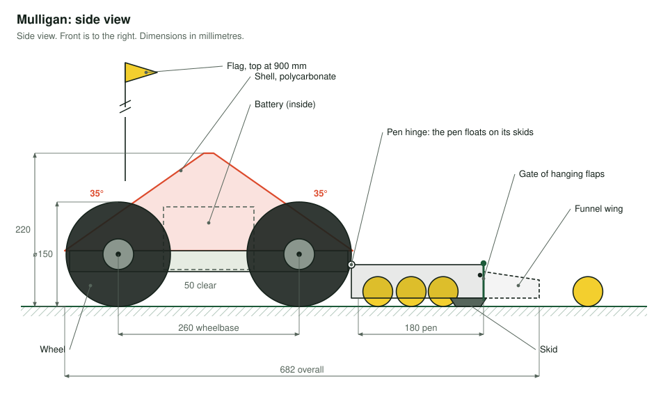
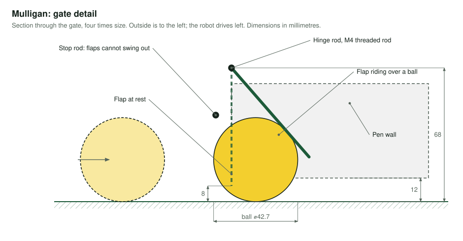
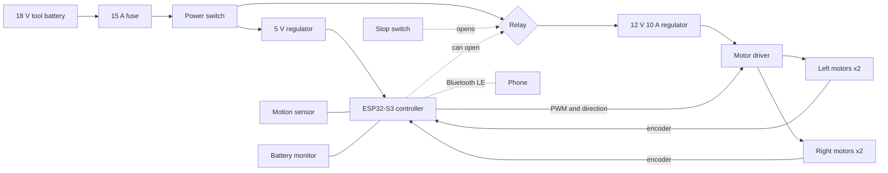
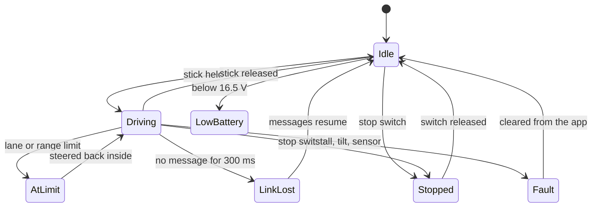

# Mulligan design

This is the design of the robot: what it is made of, how big it is, why it is that way, and what to buy. The [build plan](README.md) says what order to build it in.

Nothing here has been built or tested. The dimensions and sizing come from [design/params.mjs](design/params.mjs), which is the one place the numbers live. Running `npm run robot:design` checks them ([design/calcs.md](design/calcs.md)) and redraws the drawings. Several inputs are assumptions, marked as such, to be replaced by measurements from the first rover.

The [3D design study and film](README.md#mulligan-in-motion) show the current onboard-storage concept with a curved fairing, chassis-mounted bin and sliding gate. The dimensions and passive pen described below are the original prototype baseline. The planar shell angles, sheet construction and strike estimates below apply to the flat-panel prototype. The curved fairing needs its own material, mounting and impact tests.

## At a glance

| | Design | Target on the site |
| --- | --- | --- |
| Size | 682 long, 425 wide, 220 mm high, flag to 900 mm | 22 cm high |
| Weight | 7.6 kg empty, 8.0 kg with ten balls | |
| Carries | Ten balls loosely; the pen floor fits 28 | 10 |
| Speed | Capped at 4 km/h. The motors cannot exceed 5.7 km/h. | 4 km/h |
| Runtime | About 4 hours on a 90 Wh battery, if it is moving half the time | 3 hours |
| Drive | Four wheels, four small geared motors, steered by driving the sides at different speeds | |
| Pickup | A bottomless pen pushed along the ground, with a gate of hanging flaps. No motors. | No motors |
| Control | Bluetooth LE from the RangeOps app | Bluetooth |

## Six choices that shape it

**1. It herds balls; it does not lift them.** The pen is a three-sided frame with no floor, hinged to the front of the chassis and riding on its own skids. Balls stay on the grass and are pushed home inside it. There is nothing to jam, no mechanism for a hand to get into, and the child unloads by picking balls out of an open-topped pen.

**2. The gate is hanging flaps, not springy fingers.** This is the part most likely to be got wrong. A golf ball weighs 46 g and rolls easily, so the only thing holding it still while the gate passes over it is the grass. Anything stiff shoves the ball along in front instead of letting it in. So the gate is a row of fifteen thin plastic strips hanging freely from a rod, each about a gram, returned by their own weight. A ball lifts three of them and needs to resist about 12 mN to do it. Range grass should hold a ball with around 70 mN, and a smooth fast surface with about 25 mN, so there is margin on grass and not much on a mat. A second rod stops the flaps swinging outward, so balls cannot leave when the robot reverses or turns.

**3. The motors are too small to be dangerous.** Four 37 mm geared motors, about 10 W each at best. Flat out with no load they turn the wheels at 5.7 km/h, so a firmware fault cannot make the robot run away. With the supply's current limit the whole robot cannot push harder than about 48 N, the weight of 5 kg. They still have four times the torque needed to climb a 10% slope from rest on grass.

**4. The motors get a regulated 12 V supply.** The battery is an 18 V tool pack whose voltage falls from 21 V to 15 V as it empties. Feeding the motors through a 12 V, 10 A regulator makes the top speed the same on a full pack and an empty one, and limits how much power can ever reach the motors.

**5. The shell is shallow at both ends.** A level ball that hits a face sloped at 35° leaves 70° above its line of flight, still travelling away from the bays, and at most a third of its energy goes into the shell. A face steeper than 45° starts to send the ball back the way it came. The robot spends most of its time pointing straight out or straight back, so the front and rear faces are the 35° ones. The sides are 55°, because a shallow side would make the robot much wider; that is a compromise to test.

**6. Batteries are swapped, not charged on the robot.** Charging a tool pack through anything but its own charger gives up the charger's protections. Staff swap a pack in seconds and charge on the maker's charger. A charging dock can come later with a purpose-made battery.

## Mechanical

### Chassis and drive

- **Plate.** 400 × 325 mm of 3 mm aluminium, 50 mm off the ground, with 30 mm walls. Plywood or HDPE sheet is fine for the first one.
- **Motors.** Four 12 V, 50:1, 37 mm gearmotors with encoders, one per wheel, on L-brackets under the plate edge. Each has a 6 mm D-shaft.
- **Wheels.** 150 mm diameter, about 45 mm wide, rubber tyre, on a clamping hub for a 6 mm shaft. Wheelbase 260 mm, track 380 mm. The wheelbase is deliberately shorter than the track so it turns on the spot without fighting itself. 120 mm off-road robot wheels are easier to buy and are fine for the first rover; they lower the top speed by a fifth and the clearance by 15 mm.
- **Wheels straight on the motor shafts.** Simple, and good enough to learn with. A ball strike or a kerb can bend a 6 mm shaft, so the pilot build should carry each wheel on its own bearing.
- **Stability.** With the battery low and central the centre of mass is about 85 mm up. It tips sideways only beyond 66°.

### Pen and gate

- **Pen.** Inside 300 mm wide and 180 mm deep. Walls of 10 mm HDPE strip, 48 mm tall, with their bottom edge 12 mm off the ground: below the middle of a ball, so a ball is pushed along and cannot squeeze under.
- **Hinge.** The pen pivots on two bolts at the chassis front, 60 mm up, and rests on two UHMW skids at its front corners. The pen follows the ground while the chassis rocks, and its weight never comes off the drive wheels. A strap limits how far it can drop or lift.
- **Funnel.** Two wings of 3 mm polycarbonate flare from the 300 mm gate to a 420 mm mouth, as wide as the wheels. They only push balls sideways along the ground, which takes no finesse, and they make aiming much easier for a child.
- **Gate.** A 3 mm stainless rod across the pen mouth, 62 mm up. Fifteen flaps of 1.5 mm polypropylene, 15 mm wide and 54 mm long, threaded on it with 5 mm spacers, tips 8 mm off the ground. A second rod just outside the flaps, 45 mm up, is the stop.
- **Skids, not a nose wheel.** A fixed wheel under the pen would scrub sideways in every turn; a skid slides any way.

### Shell and flag

- **Shape.** A hip roof: 414 × 324 mm at its base, 80 mm off the ground, rising to a short ridge at 220 mm.
- **Material.** 4.5 mm polycarbonate, cut as four flat panels on an aluminium angle frame, mounted to the chassis on rubber bushes so the shell can give. Whether that survives a full shot is for the strike test to say, not this document.
- **What it does not cover.** The tyres stand outside the shell and rise above its lower edge. They are rubber and will take a hit, but a ball can come off a tyre in any direction.
- **Flag.** A fibreglass whip mounted to the chassis behind the ridge, flag at 900 mm.

The shell and flag are for the pilot build. The rover and pickup stages run without them.

## Electrical

- **Two ways to cut motor power, neither needing software to work.** The motor supply passes through a relay. The stop switch on the robot opens the relay's coil circuit directly. The controller can open it too. The controller and its sensors stay powered either way, so the robot can report why it stopped.
- **Motors.** The two left motors share one driver channel and the two right motors the other. One encoder per side is read, from the rear wheels; the front encoders are spares.
- **Stall.** All four motors stalled would draw 22 A; the regulator limits them to 10 A. Firmware treats a commanded wheel that is not turning for half a second as a fault and cuts the drive.
- **Battery protection.** Do not assume the pack protects itself from being run flat; with some makes that job belongs to the tool. Firmware stops driving at 16.5 V and powers down at 15 V. Add a hardware low-voltage cut-off for anything left unattended.
- **Encoders run on 5 V** and the controller's pins are 3.3 V, so their outputs go through a level shifter.

Controller pins, on an ESP32-S3 DevKitC-1. They avoid the pins the module uses for start-up, USB and its own memory.

| Pin | Use | Pin | Use |
| --- | --- | --- | --- |
| 4, 5 | Left motors: PWM, direction | 8, 9 | I²C: motion sensor, battery monitor |
| 6, 7 | Right motors: PWM, direction | 2 | Stop switch state |
| 15, 16 | Left encoder A, B | 42 | Relay enable |
| 17, 18 | Right encoder A, B | 38 | Status light |
| 40 | Ball counter at the gate (optional) | 39 | Beeper |
| 10–14, 21 | Reserved for an ultra-wideband radio | 41 | Dock sensor (later) |

## Firmware

The control loop runs 100 times a second:

1. Read the latest drive message, the encoders, the motion sensor and the battery.
2. Turn the stick into a forward speed and a turn rate. Full forward is 1.11 m/s; full sideways is a pivot at about 85° a second.
3. Apply the safety rules, in this order. Any of them can force a stop: stop switch, link timeout, tilt beyond 35° or a stall, low battery, lane limit, speed cap.
4. Limit acceleration to 1 m/s² and braking to 2.5 m/s², and run a speed controller for each side against its encoder.
5. Send telemetry five times a second.

Stopping distances follow from those numbers: 0.25 m when the stick is released, and 0.58 m when the link drops, because the robot waits out the 300 ms timeout first. To get the shorter one, the app sends an explicit zero when the stick is released and does not rely on the timeout.

**Lane limit.** The robot tracks its position from the encoders and the motion sensor's heading, zeroed where it starts at the bay: distance out, distance across, and which way it faces. The allowed area is a box, out to 30 m and half a lane either side. The box is shrunk by how unsure the robot is, which grows with every metre driven since it was last zeroed. At the edge it obeys only the part of the stick that takes it back inside, so a child can always drive home. The message format is in the [control link](README.md#control-link-draft).

How well this holds a single bay at 30 m is unknown and probably not well enough: 2.9° of heading error is the whole budget. That is what the first rover measures, and why the pins for an ultra-wideband radio are reserved.

## Parts

Examples are starting points, not endorsements. Check each against its datasheet before ordering. I have not priced this list.

| Part | Qty | What to look for | Example |
| --- | --- | --- | --- |
| Gearmotor with encoder | 4 | 12 V, 37 mm, about 50:1, 200 rpm unloaded, 2 N·m stall, 6 mm D-shaft | Pololu 37D 50:1 with 64 CPR encoder |
| Motor bracket | 4 | To suit the motor | Pololu 37D L-bracket |
| Wheel and hub | 4 | 150 mm rubber tyre, clamping hub for a 6 mm D-shaft | 120 mm "Wild Thumper" wheels for the rover |
| Motor driver | 1 | Two channels, 10 A each, 12 V, PWM and direction inputs that accept 3.3 V | Cytron MDD10A |
| Controller | 1 | ESP32-S3 module on a development board | ESP32-S3-DevKitC-1 |
| Motion sensor | 1 | Six or nine axis with heading fused on the chip, I²C | BNO085 breakout |
| Battery monitor | 1 | Voltage and current, I²C, 26 V rated | INA219 or INA226 breakout |
| Battery | 2 | 18 V tool pack, 5 Ah (90 Wh), and its own charger | Whichever tool system is already in the shed |
| Battery adapter | 1 | Dock for that make of pack, with wire tails | Sold as a "power wheels adapter" |
| Motor regulator | 1 | 12 V out, 10 A, 15–21 V in, current limited | |
| Logic regulator | 1 | 5 V out, 3 A | |
| Relay | 1 | Automotive, 12 V coil, 30 A contacts | |
| Stop switch | 1 | Latching mushroom button, sealed | |
| Fuse and holder | 1 | 15 A blade | |
| Level shifter | 1 | Four channels, 5 V to 3.3 V | |
| Chassis plate | 1 | 400 × 325 × 3 mm aluminium | |
| Pen walls | | 10 × 48 mm HDPE strip, 700 mm in all | |
| Skids | 2 | UHMW block, about 50 × 15 × 12 mm | |
| Gate rods | 2 | 3 mm stainless, 320 mm | |
| Flaps | 15 | 1.5 mm polypropylene sheet, 15 × 54 mm | A cheap chopping mat |
| Shell | | 4.5 mm polycarbonate sheet, about 0.35 m², and aluminium angle | Pilot build only |
| Flag | 1 | Fibreglass whip with flag | A child's bike flag |

## What to test first

1. **The gate, by hand.** Build only the pen and gate, about two hours with a saw and a drill. Push it by hand at walking pace over balls on a range mat, short grass, long grass, wet grass and a divot. Count how many of twenty go in on each. Then try heavier flaps and lighter ones. If the gate does not work on grass, nothing else in this document matters.
2. **Retention.** With ten balls in, pull the pen backwards and swing it through a tight turn. None should escape.
3. **The rover on grass.** Top speed, stopping distances, an hour's power draw, and heading drift over ten 30 m out-and-back runs. These replace every figure marked as assumed in the sizing checks.
