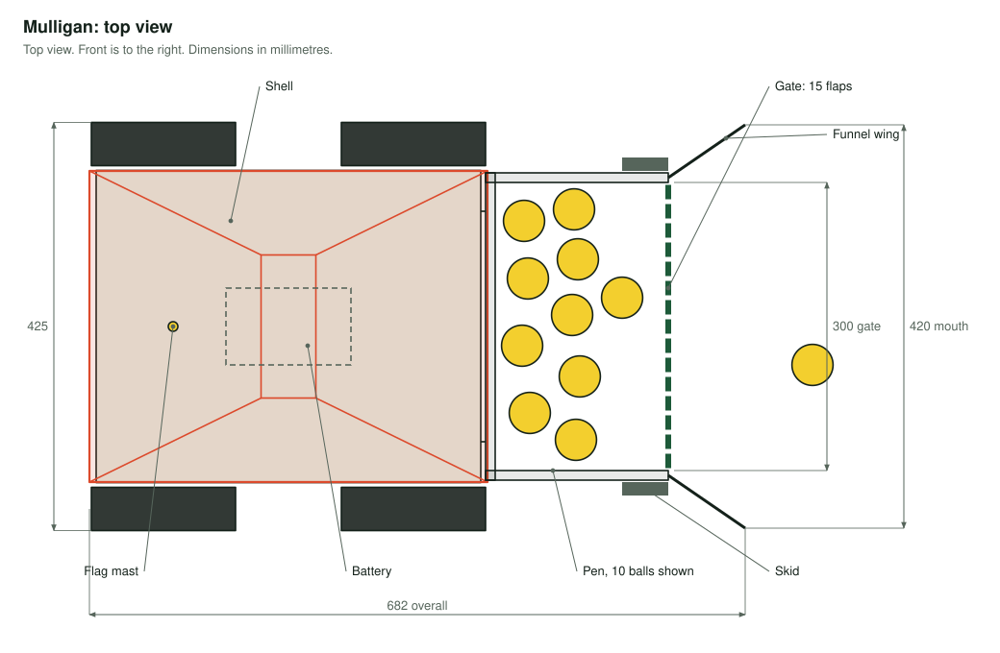
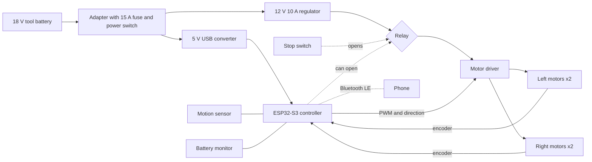
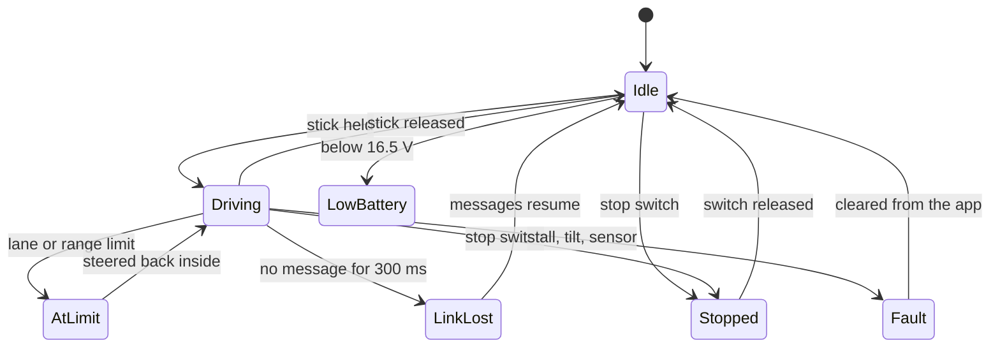

# Mulligan design

This is the design of the robot: what it is made of, how big it is, and why it is that way. The [build plan](README.md) says what order to build it in, and [BUILD.md](BUILD.md) says what to buy and how to put it together.

Nothing here has been built or tested. The dimensions and sizing come from [design/params.mjs](design/params.mjs), which is the one place the numbers live. Running `npm run robot:design` checks them ([design/calcs.md](design/calcs.md)) and redraws the drawings, and the [3D model](cad/README.md) reads the same file. Several inputs are assumptions, marked as such, to be replaced by measurements from the first rover.

## At a glance

| | Design | Target on the site |
| --- | --- | --- |
| Size | 726 long, 422 wide, 220 mm high, flag to 900 mm | 22 cm high |
| Weight | 7.1 kg empty, 7.5 kg with ten balls | |
| Carries | Ten balls loosely; the pen floor fits 21 | 10 |
| Speed | Capped at 4 km/h. The motors cannot exceed 6.1 km/h. | 4 km/h |
| Runtime | About 4 hours on a 72 Wh (18 V, 4 Ah) battery, if it is moving half the time | 3 hours |
| Drive | Four wheels, four geared motors, steered by driving the sides at different speeds | |
| Pickup | A bottomless pen pushed along the ground, with a gate of hanging flaps. No motors. | No motors |
| Control | Bluetooth LE from the RangeOps app | Bluetooth |
| Made from | Bought parts bolted together with hand tools. No drilling, soldering, printing or machining. | |

## Seven choices that shape it

**1. It is built from parts you buy, not parts you make.** The metal is goBILDA, an aluminium construction system sold to school robotics teams: channel, plate, motors, hubs and wheels that all share one hole pattern and bolt together with M4 screws and a hex key. The panels are corrugated plastic sign board, cut with a craft knife and held with cable ties. The electronics are boards with screw terminals and plug-in leads. Someone who has never built anything can put it together, and the same frame carries the robot from the first rover to the pilot. The cost is that some sizes are set by the parts: axles and pivots sit on holes 24 mm apart, the wheels are 144 mm because that is the size goBILDA makes, and the motors are bigger than the robot needs.

**2. It herds balls; it does not lift them.** The pen is a three-sided frame with no floor, pivoting on the front of the chassis and riding on its own skids. Balls stay on the grass and are pushed home inside it. There is nothing to jam, no mechanism for a hand to get into, and the child unloads by picking balls out of an open-topped pen.

**3. The gate is hanging flaps, not springy fingers.** This is the part most likely to be got wrong. A golf ball weighs 46 g and rolls easily, so the only thing holding it still while the gate passes over it is the grass. Anything stiff shoves the ball along in front instead of letting it in. So the gate is a row of fifteen thin plastic strips hanging freely from a rod, each about a gram, returned by their own weight. A ball lifts three of them and needs to resist about 12 mN to do it. Range grass should hold a ball with around 70 mN, and a smooth fast surface with about 25 mN, so there is margin on grass and not much on a mat. A second rod stops the flaps swinging outward, so balls cannot leave when the robot reverses or turns.

**4. What the motors can do is limited by their supply, not their size.** The goBILDA motors are strong, about 22 W each at best, with eight times the torque needed to climb a 10% slope from rest on grass. Flat out with no load they turn the wheels at 6.1 km/h, so a firmware fault cannot make the robot run away. What keeps the robot gentle is the 10 A limit on the motor supply: the whole robot cannot push harder than about 52 N, the weight of 5 kg.

**5. The motors get a regulated 12 V supply.** The battery is an 18 V tool pack whose voltage falls from 21 V to 15 V as it empties. Feeding the motors through a 12 V regulator with a 10 A current limit makes the top speed the same on a full pack and an empty one, and sets the push limit above.

**6. The shell is shallow at both ends.** A level ball that hits a face sloped at 35° leaves 70° above its line of flight, still travelling away from the bays, and at most a third of its energy goes into the shell. A face steeper than 45° starts to send the ball back the way it came. The robot spends most of its time pointing straight out or straight back, so the front and rear faces are the 35° ones. The sides are 55°, because a shallow side would make the robot much wider; that is a compromise to test.

**7. Batteries are swapped, not charged on the robot.** Charging a tool pack through anything but its own charger gives up the charger's protections. The shell hinges up from its front edge, so staff swap a pack in seconds and charge it on the maker's charger. A charging dock can come later with a purpose-made battery.

## Mechanical

The parts, quantities and goBILDA part numbers are in [BUILD.md](BUILD.md#shopping-list).

### Chassis and drive

- **Rails.** Two goBILDA 1120 U-channels, 48 × 48 mm and 456 mm long, 280 mm apart across their outside faces, with their open sides facing each other. The axles run through the middle of the rails, so the rails stand from 48 to 96 mm off the ground.
- **Floor.** A goBILDA grid plate, 424 × 232 mm, bolted across the rails' bottom flanges. It ties the rails together, and the battery and boards fix to its holes. Ground clearance is 48 mm, enough to pass over a ball.
- **Motors.** Four goBILDA 5203 gearmotors, 12 V, 26.9:1, 223 rpm, with encoders. Each bolts by its face to the inside of a rail, with its 8 mm shaft out through the rail's middle hole. They sit at the 4th hole from the back and the 5th from the front, 240 mm apart.
- **Wheels.** goBILDA Wasteland wheels, 144 mm across and 52 mm wide, rated for 6 kg each, on Hyper Hubs on the motor shafts. Track 370 mm. The wheelbase is deliberately shorter than the track, so it turns on the spot without fighting itself.
- **Wheels straight on the motor shafts.** The gearbox carries its shaft on two ball bearings, which suits a robot this light. A hard ball strike on a wheel loads the gearbox, which is one more thing the strike test should watch.
- **Stability.** With the battery central the centre of mass is about 95 mm up, an *assumed* figure. It tips sideways only beyond 63°, and end over end beyond 52°.

### Pen and gate

- **Pen.** Inside 300 mm wide and 170 mm deep. The side walls are two goBILDA U-channels, 240 mm long and 48 mm tall, with their flat faces inward. Their bottom edge is 12 mm off the ground: below the middle of a ball, so a ball is pushed along and cannot squeeze under. The back wall is a strip of corrugated plastic cable-tied between them.
- **Pivot.** An angle bracket stands on the back of each pen wall. An M4 bolt runs from inside each rail, through a hole near its front end 80 mm up, then through a 10 mm spacer and the bracket. The pen rests on two nylon furniture glides near its front. It follows the ground while the chassis rocks, and its weight never comes off the drive wheels.
- **Funnel.** Two wings of corrugated plastic flare from the 300 mm gate to a 420 mm mouth, as wide as the wheels. They only push balls sideways along the ground, which takes no finesse, and they make aiming much easier for a child.
- **Gate.** An M4 threaded rod across the pen mouth, 68 mm up, held by a bracket on each wall. Fifteen flaps of 1.5 mm polypropylene, cut from a chopping mat, 15 mm wide and 60 mm long. Each one is folded over the rod and held by a loose cable tie, with 5 mm nylon spacers between them, and its tip is 8 mm off the ground. A second rod through the walls, 8 mm outside the flaps and 44 mm up, is the stop.
- **Skids, not a nose wheel.** A fixed wheel under the pen would scrub sideways in every turn; a skid slides any way.

### Shell, skirts and flag

- **Shape.** A hip roof: 428 × 290 mm at its base, resting on the top of the rails 96 mm off the ground, rising to a short ridge at 220 mm. Its sloped sides clear the motors, which sit inside the rails.
- **Material.** 4 mm corrugated plastic, cut as five flat panels whose sizes are in [calcs.md](design/calcs.md#panels-to-cut), joined with cable ties and tape. It is light, cheap and easy to cut, but may not survive a full shot. For the strike test and the pilot, the same shapes can be ordered cut from 4.5 mm polycarbonate. Whether that survives is for the strike test to say, not this document.
- **Hinge.** The front edge is cable-tied loosely to the rails, so the shell lifts from the back to reach the battery. Two hook-and-loop straps hold the back edge down.
- **Skirts.** Two strips of the same plastic close the chassis ends below the shell, so grass and fingers stay out.
- **What it does not cover.** The tyres stand outside the shell and rise above its lower edge. They are rubber and will take a hit, but a ball can come off a tyre in any direction.
- **Flag.** One section of a child's bike-flag pole, dropped through holes in the left pen wall, with the flag at 900 mm.

The shell, skirts and flag are for the pilot build. The rover and pickup stages run without them.

## Electrical

Everything connects without soldering: screw terminals, plug-in leads and lever connectors. The wiring, step by step, is in [BUILD.md](BUILD.md#wiring).

- **Two ways to cut motor power, neither needing software to work.** The motor supply passes through a relay. The stop switch on the robot opens the relay's coil circuit directly. The controller can open it too. The controller and its sensors stay powered either way, so the robot can report why it stopped.
- **Motors.** The two left motors share one driver channel and the two right motors the other. One encoder per side is read, from the rear wheels; the front encoders are spares.
- **Stall.** All four motors stalled would draw 37 A; the regulator limits them to 10 A. Firmware treats a commanded wheel that is not turning for half a second as a fault and cuts the drive.
- **Battery protection.** Do not assume the pack protects itself from being run flat; with some makes that job belongs to the tool. Firmware stops driving at 16.5 V and powers down at 15 V. Add a hardware low-voltage cut-off for anything left unattended.
- **Encoders run on the controller's 3.3 V supply.** The goBILDA encoders work from 3.3 to 5 V, so their signals suit the controller's 3.3 V pins as they are.

Controller pins, on an ESP32-S3 DevKitC-1. They avoid the pins the module uses for start-up, USB and its own memory.

| Pin | Use | Pin | Use |
| --- | --- | --- | --- |
| 4, 5 | Left motors: PWM, direction | 8, 9 | I²C: motion sensor, battery monitor |
| 6, 7 | Right motors: PWM, direction | 2 | Stop switch state |
| 15, 16 | Left encoder A, B | 42 | Relay enable |
| 17, 18 | Right encoder A, B | 38 | Status light |
| 40 | Ball counter at the gate (optional) | 39 | Beeper |
| 10–14, 21 | Reserved for an ultra-wideband radio | 41 | Dock sensor (later) |

## Firmware

The control loop runs 100 times a second:

1. Read the latest drive message, the encoders, the motion sensor and the battery.
2. Turn the stick into a forward speed and a turn rate. Full forward is 1.11 m/s; full sideways is a pivot at about 85° a second.
3. Apply the safety rules, in this order. Any of them can force a stop: stop switch, link timeout, tilt beyond 35° or a stall, low battery, lane limit, speed cap.
4. Limit acceleration to 1 m/s² and braking to 2.5 m/s², and run a speed controller for each side against its encoder.
5. Send telemetry five times a second.

Stopping distances follow from those numbers: 0.25 m when the stick is released, and 0.58 m when the link drops, because the robot waits out the 300 ms timeout first. To get the shorter one, the app sends an explicit zero when the stick is released and does not rely on the timeout.

**Lane limit.** The robot tracks its position from the encoders and the motion sensor's heading, zeroed where it starts at the bay: distance out, distance across, and which way it faces. The allowed area is a box, out to 30 m and half a lane either side. The box is shrunk by how unsure the robot is, which grows with every metre driven since it was last zeroed. At the edge it obeys only the part of the stick that takes it back inside, so a child can always drive home. The message format is in the [control link](README.md#control-link-draft).

How well this holds a single bay at 30 m is unknown and probably not well enough: 2.9° of heading error is the whole budget. A robot that steers by running its sides at different speeds slides its wheels in every turn, so the wheel counts say little about heading and the motion sensor carries it all. That is what the first rover measures, and why the pins for an ultra-wideband radio are reserved.

## What to test first

1. **The gate, by hand.** Build the pen and gate first, from the real parts, as the first step in [BUILD.md](BUILD.md#1-the-pen-and-gate-about-a-day). Push it with a broom handle at walking pace over balls on a range mat, short grass, long grass, wet grass and a divot. Count how many of twenty go in on each. Then try heavier flaps and lighter ones. If the gate does not work on grass, nothing else in this document matters.
2. **Retention.** With ten balls in, pull the pen backwards and swing it through a tight turn. None should escape.
3. **The rover on grass.** Top speed, stopping distances, an hour's power draw, and heading drift over ten 30 m out-and-back runs. These replace every figure marked as assumed in the sizing checks.
