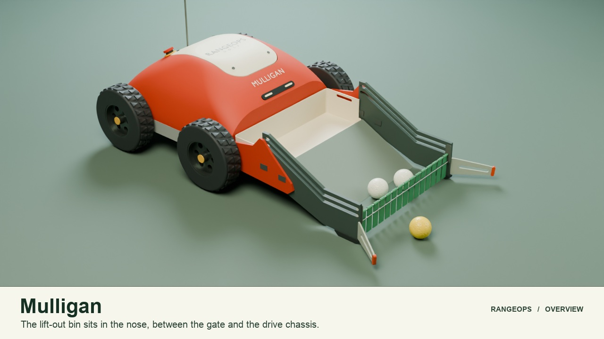

# Mulligan, the RangeOps robot

Mulligan is a knee-high remote-control buggy that lives at a driving range bay. A child drives it out from a phone, rolls it over the short shots to scoop them up, and drives them back to hit again. A range hires it out with a bay booking, through the RangeOps app or another booking platform; see [docs/PLAN.md](../docs/PLAN.md#built-to-swap).

Nothing here is built yet. The first build is a private proof of concept, tested by the builder with no children and no public demos, so the strike-proof shell and the pilot's safety work come later (stage R3). This is the plan for building it, and [DESIGN.md](DESIGN.md) is the design: dimensions, drawings, parts and the reasons behind them. [BUILD.md](BUILD.md) is how to build it from bought parts with hand tools, for someone who has never built anything, and there is a 3D model of it in [cad/](cad/README.md). Firmware and test notes will live in this folder as they appear. How the robot fits with the app and the rest of the offering is in [docs/PLAN.md](../docs/PLAN.md).

## Mulligan in motion

**This is a styled concept, not the build.** The film and its 3D model show where the design could go: a curved fairing, a lift-out bin in the nose and a gate that slides back to stow the balls. They were drawn on the earlier design's numbers, before the switch to bought parts. The robot to build first is the one in [BUILD.md](BUILD.md) and [cad/](cad/README.md): goBILDA metal, a Corflute shell and a passive pen. The sliding gate is also a powered moving part, which the passive pen avoids, so it needs its own safety case before it goes near children.

[](drawings/mulligan.mp4)

The [short film](drawings/mulligan.mp4) follows one yellow ball from the turf into Mulligan’s lift-out bin. The bin sits on an extension of the chassis tray, ahead of the front motors. Allowing room for the bin and ramp brings the robot to about 780 mm long and 426 mm wide. Red side panels connect the carriage rails to the nose. The ramp meets the lowered front rim of the bin, whose side and rear walls are 60 mm high.

Open the [robot assembly](drawings/mulligan.glb) and play **Collect and stow** for the complete cycle. After the yellow ball passes the flaps, the buggy stops and the same gate slides back along the rails, transfers three balls and returns to the mouth. **Assembly breakdown** shows the bin lifting out of its pocket. **Passive pickup** isolates the first part of the cycle.

The film illustrates the intended motion on level ground. The transfer actuator, force limit and performance on turf still need development. The drawings and strike calculations in [DESIGN.md](DESIGN.md) describe the earlier flat-panel prototype.

### Sliding catcher bench test

The [hand-transfer jig](drawings/transfer-jig.glb) explores a button-operated catcher before choosing an actuator. Play **Hand transfer** to see the flap carriage follow the ramp, deposit three balls and return. The 70 mm lip and 218 mm horizontal stroke are trial dimensions. Ball positions illustrate the intended transfer. On the physical jig, try three balls abreast, then put one ball 10 mm down in a depression. Record where it catches and the peak pull on the grip during each stroke. The [jig source](design/transfer_jig.py) builds with `cad run robot/design/transfer_jig.py`.

### Simulate two pickups on the CAD assembly

From the repository root, install the local viewer dependency once, start the simulator, and open the URL it prints.

```sh
npm ci --prefix robot/design
uv run robot/design/simulate.py --serve
```

The yellow ball starts 64 mm right of centre. The white ball starts 300 mm further downrange at the selected lateral offset (positive is left). Both balls remain live across both pickups. Use **Top** to see which flaps open and where the balls end up. Use **Catcher** or **Side** to inspect the gate stroke. Drag to orbit, or scrub to either return stroke.

**First load** requires the first ball to settle at bin-floor height for half a second with recent floor contact. **First retained** also requires it to stay within the bin envelope throughout the second cycle and settle again. **Second load** reports pickup and storage for the white ball. Change the offset, bin side and rear wall height, flap-tip clearance, sweep speed or horizontal force limit to compare rows. The bin floor and lowered entry lip stay at their CAD heights when adjusting the walls.

The viewer loads the [CAD assembly](drawings/mulligan.glb) and drives its carriage, individual flaps and wheels from MuJoCo. The [course model](design/course.py) reads the ramp, rail, wing, skid and fairing meshes from that same export for convex collision surfaces. It uses separate bin walls to keep the pocket open, spherical balls, cylindrical tyres and hinged flap blades. The chassis can rise, pitch and roll on its wheels and skids. The straight-line drive is prescribed. Soil deformation, steering, tyre compliance and motor traction require other tests. The default 1.5 N gate limit and friction values are assumptions.

For a headless comparison or a starting scene for inspection:

```sh
uv run robot/design/simulate.py --course --lane 185 --wall 60
uv run robot/design/simulate.py --course --depth 20 --location wheel --xml /tmp/mulligan-course.xml
```

After changing CAD dimensions, re-export the GLB using the commands below, then reload the page. The settings in the browser are trial overrides.

### Single-ball bench

The **Single-ball bench** link opens the original level-chassis side section. The [recorded bench trials](drawings/catcher-replay.html) also work offline for level ground and 10 mm and 20 mm divots. To run one headlessly, use `uv run robot/design/simulate.py --depth 20 --tip 8 --sweep 87`. Use `--replay /tmp/catcher.html` to save the three traces as a standalone replay.

### Rebuild the model and film

With Node.js and text-to-cad installed, run the following from the repository root. Use the model ID printed by each CAD build for its export.

```sh
cad run robot/design/mulligan.py
cad model export <model-id> robot/drawings/mulligan.glb --tolerance 0.045 --angle 9
cad run robot/design/film.py
```

The [CAD model](design/mulligan.py) reads [the design parameters](design/params.mjs). The [Blender scene](design/film.py) renders the robot and all three balls from that one exported assembly. Add `--draft` to the film command for sample frames in the system temporary directory.

## Target spec

These are the numbers on the site. They are targets to design towards, not measurements.

| | Target | Note |
| --- | --- | --- |
| Carries | 10 balls a trip | About 0.46 kg of balls, so load is not what sizes the motors. |
| Reach | 30 m from the bay | Sets the radio range and the lane-limit problem. |
| Top speed | 4 km/h | 1.1 m/s, a walking pace. Capped in firmware. |
| Height | 22 cm to the shell | Low enough for most shots to pass over. |
| Runtime | 3 hours a charge | Three one-hour hires between charges. |
| Control | Bluetooth, from a phone or iPad | No internet needed to drive. |

## What the safety promises require

The site makes four promises to parents and range owners. Each one is an engineering requirement, and each must hold with the app misbehaving or absent, so all four live in the robot.

| Promise | What the robot has to do |
| --- | --- |
| **Hold to drive.** It moves only while a thumb is on the stick, and stops if the signal drops. | The app sends drive messages continuously while the stick is held, and an explicit zero when it is released. Firmware also stops the motors when no valid message has arrived for 300 ms. From top speed the robot stops in about 25 cm on release and about 60 cm on a lost signal. |
| **Stays in its lane.** It keeps within 30 m and in front of its own bay. | The robot estimates its own position relative to the dock and refuses to drive further out of bounds. This is the hardest requirement here; see [Knowing where it is](#knowing-where-it-is). |
| **Takes a direct hit.** A stray ball does not break it. | A low shell that is shallow at both ends, so a ball glances off and carries on up the range instead of coming back toward the bays, with the battery and electronics behind it. Proven by hitting balls at it. |
| **Nothing spins.** No rollers or blades for small hands. | A passive pickup: balls push past light hanging flaps into a pen and cannot roll back out. The only moving parts a child can reach are the wheels, at walking pace, driven by motors too small to push hard. |

Two more that the site does not mention but a range will ask about: a physical stop switch on the robot that anyone can hit, and a flag tall enough to be seen from every bay.

## Subsystems

**Pickup.** A bottomless pen at the front with a gate of light flaps hanging from a rod. Driving over a ball lifts the flaps; they fall back behind it and a stop rod keeps them from swinging out. The flaps have to be nearly weightless, because grass is all that holds a ball still while the gate passes over it. Unloading is by hand at the mat. This is the part with no off-the-shelf answer and the one to prototype first, by hand, with no electronics, from the same parts the robot uses: flap weight and spacing; whether it works on wet grass, in a divot and at the edge of a mat; whether ten balls stay in on the drive home.

**Chassis and drive.** Four wheels, driven as left and right sides and steered by running the sides at different speeds, as in the drawing on the site. It is built from goBILDA parts, an aluminium construction system that bolts together with a hex key: two channel rails, a floor plate, four geared motors with encoders, and 144 mm wheels. The same frame serves from R0 to the pilot, so there is no throwaway chassis.

**Electronics.**

- Controller: an ESP32-S3 module. It has Bluetooth LE for driving and Wi-Fi for updating firmware in the workshop, and it comes as a pre-certified radio module.
- A motor driver sized for the motors' stall current, not their running current.
- Wheel encoders and a six-axis motion sensor, for speed control, distance travelled, heading and detecting a flip or a stall.
- A stop switch, a power switch and a status light.
- Optional: a light-beam sensor across the corral gate to count balls in. The app's display of balls on board depends on it.

**Power.** Use an 18 V power-tool battery for R0 to R2, feeding the motors through a 12 V regulator. A charger already exists and the pack swaps in seconds. Do not count on the pack to protect itself from being run flat; the firmware cuts off first. Measure the real power draw on grass with R0 before choosing a capacity: three hours is the target, and it cannot be estimated well from a bench.

**Dock.** A parking spot at the bay that gives the robot a known starting position and heading. Batteries are swapped by staff and charged on their own charger; charging on the dock waits for a purpose-made battery. Not needed until R2.

**Firmware.** One loop: read the drive message, apply the safety rules, run the motors, report telemetry. The safety rules run in this order and any one of them can force a stop: stop switch, signal timeout, tilt or stall, lane limit, speed cap.

## Knowing where it is

Holding the lane is the hard problem. A bay is about three metres wide and the robot works up to 30 m out, so being three degrees wrong about its heading puts it a metre and a half to one side, in front of the next bay.

The options, cheapest first:

| Approach | How | Weakness |
| --- | --- | --- |
| Odometry and gyro | Count wheel turns and integrate heading from the dock. | Drifts with wheel slip on grass and with time. Probably too loose for a single-bay lane at 30 m. |
| Signal strength | Estimate distance from the Bluetooth signal. | Distance only, and rough. Useful as a backstop for the 30 m limit, not for the lane. |
| Ultra-wideband ranging | A radio beacon on the dock; the robot measures its distance to it within tens of centimetres. Two beacons give a position. | More hardware on both robot and dock. |
| Satellite positioning with correction | Centimetre-level outdoors. | Costly, needs a base station, and fails under a bay roof. |

Plan: build R0 with odometry and a gyro and measure the drift over a 30 m out-and-back run on grass. If it holds a bay width, good. Assume it will not, and design R2 around ultra-wideband with odometry filling the gaps. For a pilot, reduce the stakes by using end bays or leaving a bay empty on either side.

## Control link (draft)

The app and the firmware both build against this, which is what lets them be built at the same time. It is a draft: change it freely until R0 drives, then version it.

One Bluetooth LE service with four characteristics. The robot advertises as `Mulligan-` followed by four characters of its serial.

| | UUID |
| --- | --- |
| Service | `618deb21-0248-48ee-8de9-e8d739eba464` |
| Drive | `618deb22-0248-48ee-8de9-e8d739eba464` |
| Telemetry | `618deb23-0248-48ee-8de9-e8d739eba464` |
| Info | `618deb24-0248-48ee-8de9-e8d739eba464` |
| Unlock | `618deb25-0248-48ee-8de9-e8d739eba464` |

| Characteristic | Direction | Rate | Contents |
| --- | --- | --- | --- |
| Drive | app to robot, write without response | 20 times a second while the stick is held | 4 bytes, below |
| Telemetry | robot to app, notify | 5 times a second | 8 bytes, below |
| Info | read | once on connect | Text: robot name, firmware version and hardware revision, separated by semicolons |
| Unlock | app to robot, write with response; also read | write once on connect, then read | Write: the hire key, 78 bytes, below. Read: 1 byte, the result of the last key written on this connection, below |

Drive, 4 bytes:

| Byte | Meaning |
| --- | --- |
| 0 | Sequence number, counting up and wrapping at 255 |
| 1 | Stick x, signed, -100 to 100, right is positive |
| 2 | Stick y, signed, -100 to 100, forward is positive |
| 3 | Flags. Bit 0: a thumb is on the stick. Bit 1: clear a fault. The robot clears a latched fault only when bit 1 is set, bit 0 is clear and the cause has gone ([ADR 0003](../docs/adr/0003-drive-flag-to-clear-a-fault.md)). The app sends it from a button shown while the state is 5 |

Telemetry, 8 bytes:

| Byte | Meaning |
| --- | --- |
| 0 | State: 0 idle, 1 driving, 2 at a limit, 3 link lost, 4 stopped by the switch, 5 fault, 6 low battery, 7 locked: no valid hire key |
| 1 | Battery, percent |
| 2 | Balls on board; 255 if the robot does not count them |
| 3 | Fault flags. Bit 0 stall, bit 1 tilt, bit 2 sensor, bit 3 low voltage |
| 4, 5 | Distance from where it was zeroed, in decimetres, low byte first; 65535 if unknown |
| 6 | Limit flags, set while a limit is overriding the stick. Bit 0 far end, bit 1 left edge, bit 2 right edge, bit 3 speed |
| 7 | The sequence number of the last Drive message it acted on |

Hire key, 78 bytes, issued by the backend for a hired robot and carried to the phone in a link:

| Bytes | Meaning |
| --- | --- |
| 0 | Version, 1 |
| 1 to 4 | The robot's four serial characters, as in its advertised name |
| 5 to 8 | Start of the hire, Unix seconds, low byte first |
| 9 to 12 | End of the hire, the same way |
| 13 | Bay number |
| 14 to 77 | Ed25519 signature over bytes 0 to 13, by the service's signing key |

The robot checks the signature against the public key in its firmware, that the serial is its own, and that the time is inside the hire. It needs no network to do that, only a clock it trusts (an open decision in [docs/PLAN.md](../docs/PLAN.md#decisions); R0 uses the anchored clock in [ADR 0002](../docs/adr/0002-robot-clock-anchored-on-hire-key.md), and [docs/research/robot-clock.md](../docs/research/robot-clock.md) recommends a DS3231 clock module).

The key is longer than one Bluetooth packet, and that's fine: a write with response that doesn't fit in one packet is sent as a long write (Prepare and Execute Write), which every phone does by itself. An iPhone app can't ask for a larger packet size, so the app must not depend on one ([docs/research/ble-iphone-to-robot.md](../docs/research/ble-iphone-to-robot.md)). Confirm on the bench that the firmware's Bluetooth library accepts the long write.

Unlock read-back, 1 byte ([ADR 0005](../docs/adr/0005-unlock-result-read-back.md)). The write itself always succeeds; the app writes the key, waits about 100 ms for the next control tick, then reads Unlock to learn why the robot is still locked:

| Value | Meaning |
| --- | --- |
| 0 | ok |
| 1 | bad length, and the value before any key is written |
| 2 | bad version |
| 3 | bad signature |
| 4 | wrong serial: a key for another robot |
| 5 | not yet: the hire has not started |
| 6 | expired |
| 7 | the robot does not know the time |

Rules:

- When the stick is released the app sends three Drive messages with x and y at zero and the flag clear, then stops sending. The robot brakes on the first.
- The robot also stops if 300 ms pass without a valid Drive message. That covers a lost signal or a crashed app; it is the backstop, not the normal way to stop.
- The sequence number lets firmware ignore a message that arrives late or out of order.
- Speed cap, acceleration ramp and lane limit are applied by the robot to whatever the stick asks for. When a limit is overriding the stick, telemetry says so, so the app can explain it.
- One controller at a time, and only with a hire key. Until a phone writes a valid key, the robot reports state 7 and ignores Drive messages. The robot forgets the key when the phone disconnects. On the bench, a key can be issued by hand.
- The app sends Drive on a "latest value wins" basis: if a write is still queued, the next one replaces it rather than queueing behind it.
- The app keeps no Bluetooth connection in the background. When it comes back to the foreground, it treats the stick as released, reconnects and writes the key again.
- The robot asks for a 15 to 30 ms connection interval with no latency, inside Apple's accessory guidelines. The 300 ms timeout stays the real stop.

One open question to settle on R0: what the stick means. The site demo steers in range terms, where pushing the stick up the screen sends the robot up the range whichever way it is facing. That is easiest for a child but needs the robot to know its heading. The simple alternative is robot terms, where up is forward and sideways is turn. Start R0 in robot terms, and switch to range terms once heading is trustworthy.

## Build stages

Each stage ends with a test on grass. The thresholds are proposals to argue with.

**R0. Bench rover.** The goBILDA chassis, the controller, motor driver, encoders, motion sensor and a tool battery. No pickup, no shell.

- Drives from a phone, held to the speed cap, and only for a phone holding a valid hire key.
- Stops within 30 cm of the stick being released, and within 60 cm when the phone is switched off or walks out of range.
- Power draw measured over an hour of stop-start driving on grass, giving a real runtime figure.
- Odometry drift measured over ten 30 m out-and-back runs.

**R1. Pickup.** The pen that worked by hand, bolted on to the rover.

- Collects ten scattered balls and brings them home, nine runs in ten.
- Loses none on the drive back, over bumps and through a turn.
- A child can unload it at the mat without help.

**R2. Lane limit and dock.** Position sensing and the dock.

- Holds its lane within a bay width at 30 m, twenty runs in a row, and stops at the limit however the stick is held.
- Parks on the dock and re-zeros its position there.
- Runs three one-hour sessions on a charge.

**R3. Pilot build.** The shell, flag and weather sealing, and a handful of units.

- Survives repeated direct strikes from a full shot, with the battery and electronics unharmed and no ball coming back toward the bays.
- Works in rain and on wet grass.
- A week at a range with real families and no engineer standing next to it.

## Open questions

- Flap weight and gate geometry for the pickup. Only the hand prototype answers this.
- Final wheel size and whether all four wheels need driving, after R0 has been on grass.
- Whether to count balls on board or drop that from the app.
- How the robot gets to and from storage at opening and closing, and who charges it.
- What radio and electrical compliance marks are needed in the launch country, and what a range's insurer wants to see.
