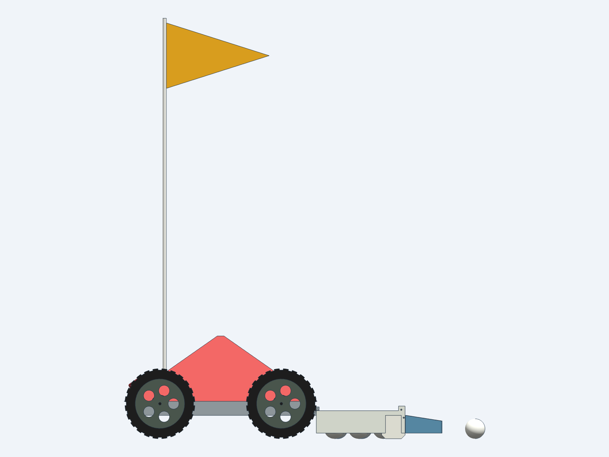
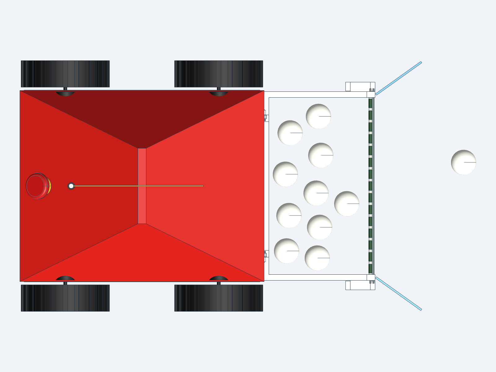

# Mulligan CAD

A 3D model of the [Mulligan design](../DESIGN.md), written as a [build123d](https://github.com/gumyr/build123d) script for [text-to-cad](https://github.com/earthtojake/text-to-cad).


| Side | Top |
| --- | --- |
|  |  |

[mulligan.py](mulligan.py) reads its numbers from [../design/params.mjs](../design/params.mjs), the same file the drawings and sizing checks use, so a change there reaches the model with no copying. Parts that `params.mjs` does not size come from the parts list in DESIGN.md and are placeholders: the electronics boxes, the hinge tabs and bolts, the gate posts and the flag's cloth.

## Models

| Model | What it is | Export |
| --- | --- | --- |
| `mulligan` | The pilot build: chassis, drive, electronics, pen and gate, shell, stop switch and flag | [STEP](exports/mulligan.step), [GLB](exports/mulligan.glb) |
| `mulligan_rover` | R0 and R1: the rover and pickup, without the shell and flag | [STEP](exports/mulligan_rover.step) |
| `mulligan_with_balls` | The pilot build with ten balls in the pen and one about to be collected | |

The model measures 681 × 425 mm, with the flag top at 900 mm. DESIGN.md gives 682 × 425 × 900 mm.

## Building it

Install text-to-cad ([instructions](https://github.com/earthtojake/text-to-cad/blob/main/docs/install.md)). The script also needs Node, which it uses to read `params.mjs`. Then, from the repository root:

```bash
cad run robot/cad/mulligan.py
```

This builds all three models and prints a viewer link and an `id` for each. To refresh the exports and renders after changing a parameter:

```bash
cad model export <mulligan id> robot/cad/exports/mulligan.step
cad model export <mulligan id> robot/cad/exports/mulligan.glb --tolerance 0.2 --angle 10
cad model export <rover id> robot/cad/exports/mulligan_rover.step
cad model snapshot <with-balls id> robot/cad/renders/mulligan.png
cad model snapshot <with-balls id> robot/cad/renders/mulligan_side.png --camera front
cad model snapshot <with-balls id> robot/cad/renders/mulligan_top.png --camera top
cad model interference <mulligan id>
```

## What the model found

**The shell hits the motors.** `cad model interference` passes for `mulligan_rover` and fails for `mulligan`: each of the four gearmotors cuts about 1.8 cm³ into the shell. The shell's lower edge rests on the chassis wall top, 80 mm up, and its sides slope in at 55°. Each motor's shaft is at axle height, 75 mm up, so the 37 mm motor body stands 94 mm tall where it meets the side wall, inside the shell's sloped sides. You can see the motor ends poking through near each wheel in the top view. Ways out, for the design to choose:

- Lift the shell about 15 mm on its rubber bushes (`shell.baseZ` 80 to 95). The slopes and the 220 mm top stay as they are, and the ridge gets longer. With that one change the interference check passes.
- Turn each motor's offset output shaft (the 37D gearbox shaft sits 7 mm off the motor's axis) to put the body lower and further inboard. On its own this gives back only about 3.5 mm.
- Mount the motors lengthwise with a right-angle gearbox.

DESIGN.md says the motors hang "on L-brackets under the plate edge", but with the plate 50 mm off the ground and the axle at 75 mm, the motor body has to sit above the plate. That is how it is modelled here.

**The stop rod's side.** DESIGN.md and the gate drawing put the stop rod outside the flaps, so they swing into the pen but never out. The side view in `../drawings/side.svg` draws it just inside them. The model follows DESIGN.md.
