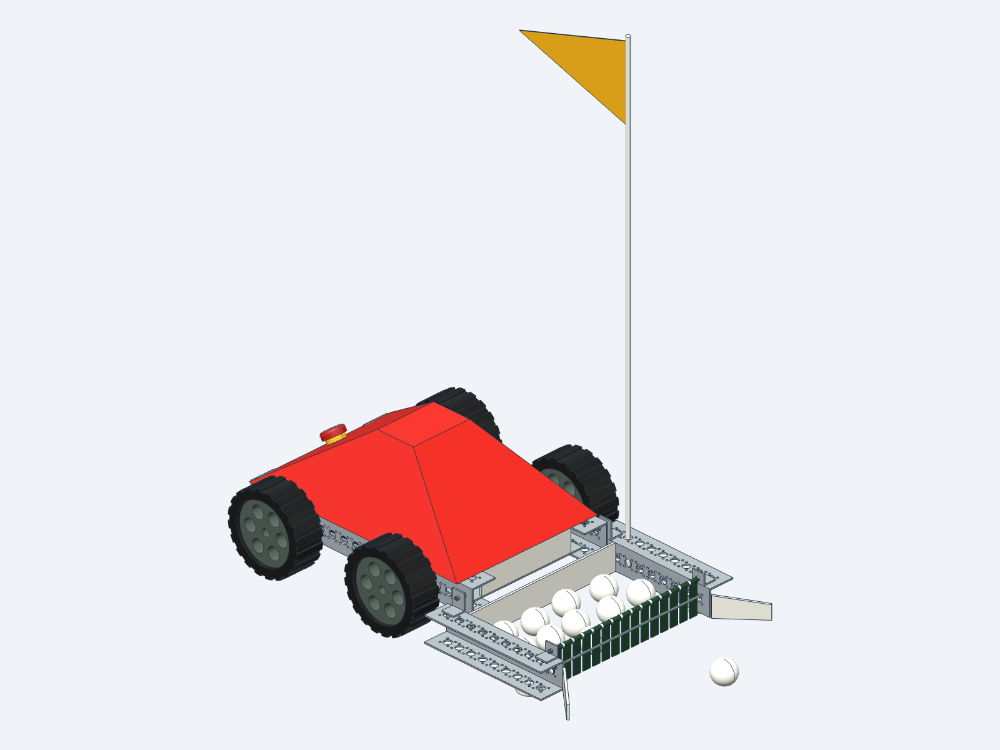
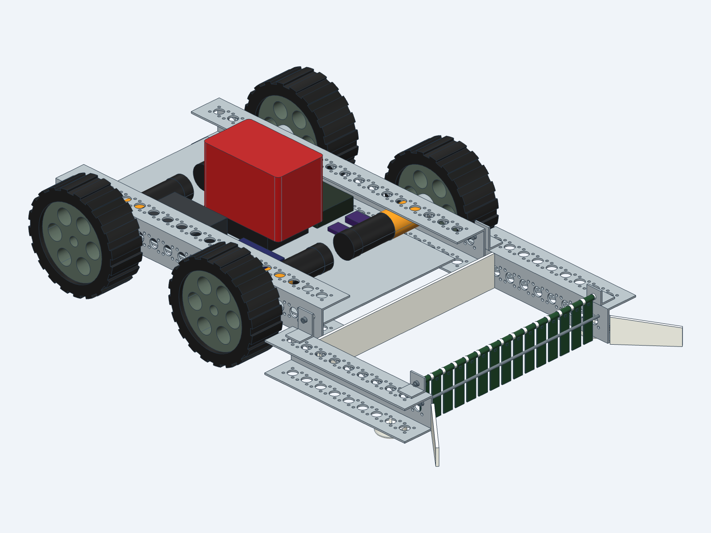
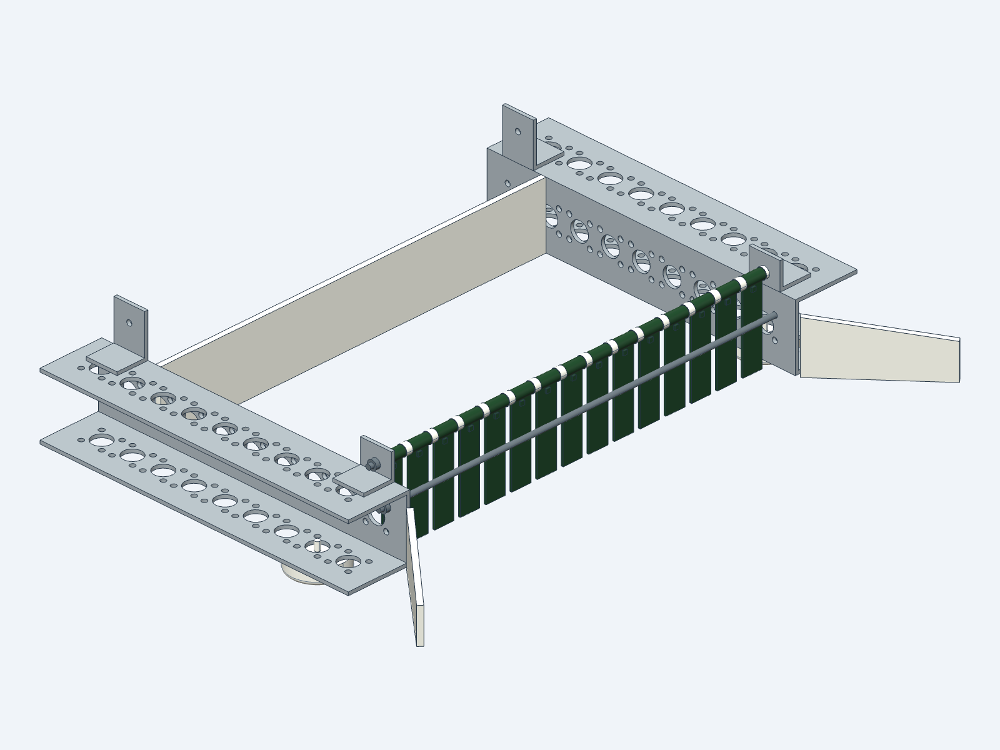

# Mulligan CAD

A 3D model of the [Mulligan design](../DESIGN.md), written as a [build123d](https://github.com/gumyr/build123d) script for [text-to-cad](https://github.com/earthtojake/text-to-cad).



| Side | Top |
| --- | --- |
|  |  |

| The rover, without its shell | The pen and gate, built first |
| --- | --- |
|  |  |

[mulligan.py](mulligan.py) reads its numbers from [../design/params.mjs](../design/params.mjs), the same file the drawings and sizing checks use, so a change there reaches the model with no copying.

The robot is made of bought parts ([../BUILD.md](../BUILD.md)), and the model draws them as bought:
- **goBILDA parts:** U-channel with its holes, grid plate, 5203 motors, Hyper Hubs, Wasteland wheels and angle brackets.
- **Corrugated plastic panels:** shell, skirts, pen back wall and funnel wings.
- **The gate:** threaded rods and polypropylene flaps.
- **Electronics:** boxes at the boards' sizes.

Where goBILDA publishes a size the model uses it; the motor's length, the hub, the channel's wall thickness and the brackets are approximate. The channel holes are drawn as goBILDA's pattern: a large hole every 24 mm starting 24 mm from the end, each with four small holes around it. The design puts every axle, pivot, rod, skid and flag pole on one of those holes.

## Models

| Model | What it is | Export |
| --- | --- | --- |
| `mulligan` | The pilot build: chassis, drive, electronics, pen and gate, shell, skirts, stop switch and flag | [STEP](exports/mulligan.step), [GLB](exports/mulligan.glb) |
| `mulligan_rover` | R0 and R1: the rover and pickup, without the shell, skirts and flag | [STEP](exports/mulligan_rover.step) |
| `mulligan_pen` | The pen and gate on their own, the first thing to build | [STEP](exports/mulligan_pen.step) |
| `mulligan_with_balls` | The pilot build with ten balls in the pen and one about to be collected | |

The model measures 725 × 423 mm, with the flag top at 900 mm. The sizing checks give 726 × 422. `cad model interference` finds no parts sharing space in any model.

## Building it

Install text-to-cad ([instructions](https://github.com/earthtojake/text-to-cad/blob/main/docs/install.md)). The script also needs Node, which it uses to read `params.mjs`. Then, from the repository root:

```bash
cad run robot/cad/mulligan.py
```

This builds all four models and prints a viewer link and an `id` for each. To refresh the exports and renders after changing a parameter:

```bash
cad model export <mulligan id> robot/cad/exports/mulligan.step
cad model export <mulligan id> robot/cad/exports/mulligan.glb --tolerance 0.5 --angle 20
cad model export <rover id> robot/cad/exports/mulligan_rover.step
cad model export <pen id> robot/cad/exports/mulligan_pen.step
cad model snapshot <with-balls id> robot/cad/renders/mulligan.png
cad model snapshot <with-balls id> robot/cad/renders/mulligan_side.png --camera front
cad model snapshot <with-balls id> robot/cad/renders/mulligan_top.png --camera top
cad model snapshot <rover id> robot/cad/renders/mulligan_rover.png
cad model snapshot <pen id> robot/cad/renders/mulligan_pen.png
cad model interference <mulligan id>
```

## What the model settled

- **The first shell hit the motors.** In the first version of the design, the shell's sloped sides cut into all four motors. Now the motors sit inside the rails and the shell rests on top of the rails, so they clear.
- **Brackets need room for a nut.** A rod or bolt through a bracket needs its hole far enough above the bracket's foot for a nut. That set the gate rod at 68 mm and the pen pivot at the rail's upper small hole, 80 mm up.
- **Everything is on a hole.** goBILDA channel only has holes every 24 mm, so the wheelbase became 240 mm and the pen 170 mm deep. A beginner then never has to drill.
