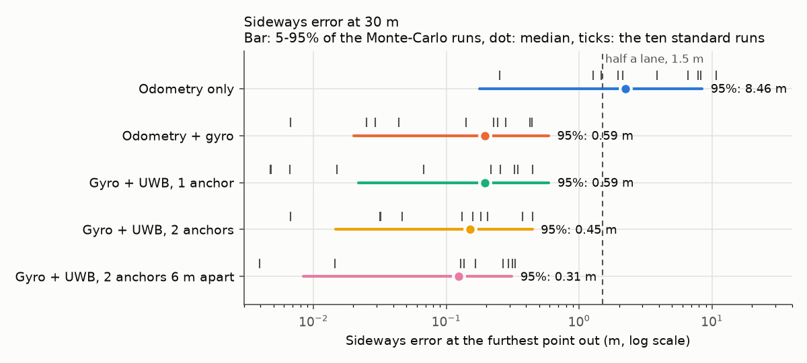
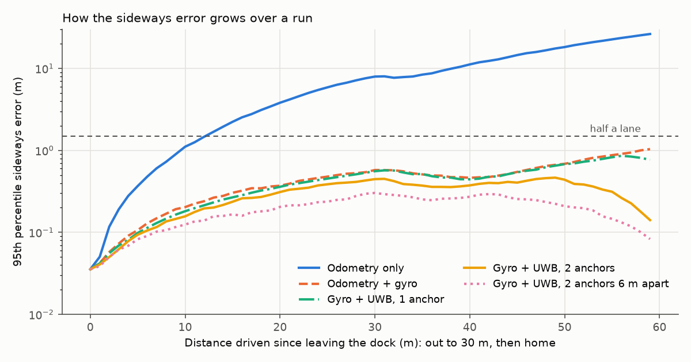

# Can Mulligan hold its lane? Simulation results

The question: can Mulligan stay in front of its own bay (3 m wide) out to 30 m, and what does
it need to know where it is? This is a simulation, not a measurement. Every number about grass,
the dock and the sensors is either cited or marked **assumed** below, and R0's test drives
should replace them. Full tables: [results/summary.md](results/summary.md). How to rerun it:
[README.md](README.md).

## Answer

**Recommendation for R2:** fuse the gyro with UWB ranging to **two anchors**, using the EKF in
`mulligan_sim/estimators.py`. Set the lane-limit **margin to 0.5 m**, so the stop line sits
1.0 m either side of the bay's centre line. Put the anchors as far apart as the site allows:
on the neighbouring bays' dividers, about 6 m apart, rather than on the dock's own corners. A
single anchor isn't worth fitting for the lane.

Why:

1. **Odometry alone cannot hold a lane.** At 30 m it is 2.2 m off sideways on a typical run
   and 8.5 m off one run in twenty. A spin turn on grass ruins its heading. To keep it inside
   nineteen runs in twenty, the margin has to be 1.4 m, which leaves a 0.2 m lane and only 5%
   of the balls in the robot's own lane within reach.
2. **Odometry plus the BNO085's gyro is far better than the plan guessed, *if* the dock
   aligns the robot to about half a degree.** At 30 m it is 0.20 m off on a typical run and
   0.59 m one run in twenty, and a 0.4 m margin keeps it inside 19 runs in 20. That result rests
   on two assumed numbers. With a 1.5° dock alignment error, the 95th percentile at 30 m rises
   to 1.6 m. With three times the datasheet's drift and a 1% scale error, the worst error in a
   run reaches 2.4 m. R0 has to measure both before odometry plus gyro could be trusted alone.
3. **Two UWB anchors make the answer robust instead of lucky.** With two anchors the error
   stays at 0.5–0.7 m in every sensitivity case, and back at the dock it is under 0.1 m, so
   every run starts clean. Dock anchors 2.8 m apart look at 30 m through poor geometry, so at
   the far end they are only a little better than the gyro (0.45 m against 0.59 m, one run in
   twenty). Anchors 6 m apart cut that to 0.31 m.
4. **One anchor fixes distance, not the lane.** A single range from the dock says how far
   out the robot is, which helps the 30 m limit and the trip home. It says almost nothing about
   sideways position, so for the lane it performs like odometry plus gyro.

| Estimator | Sideways error at 30 m: median / 95th pct | Margin for 19 in 20 inside (robot's centre) | Lane left | In-lane balls reachable | Margin for the whole body inside |
| --- | ---: | ---: | ---: | ---: | ---: |
| Odometry only | 2.22 / 8.46 m | 1.4 m | 0.2 m | 5% | 1.4 m |
| Odometry + gyro | 0.20 / 0.59 m | 0.4 m | 2.2 m | 87% | 0.6 m |
| Gyro + UWB, 1 anchor | 0.20 / 0.59 m | 0.5 m | 2.0 m | 83% | 0.7 m |
| Gyro + UWB, 2 anchors at the dock (2.8 m apart) | 0.15 / 0.45 m | 0.4 m | 2.2 m | 94% | 0.6 m |
| Gyro + UWB, 2 anchors 6 m apart | 0.12 / 0.31 m | 0.3 m | 2.4 m | 99% | 0.5 m |

**Why 0.5 m and not the bare 19-in-20 number:** the 19-in-20 margin still lets one run in
twenty cross. Adding 0.1 m takes every UWB option to 99% or more, and with anchors 6 m apart
0.5 m also keeps the whole body, not just the centre, inside 19 runs in 20. With anchors on
the dock's own corners, use 0.6 m for the same body guarantee. All these margins also cover
about 4 cm that the robot overshoots the stop line even with perfect sensing, from braking at
creep speed and the two sides ramping separately while it turns.

## Plots

The gyro estimators keep growing on the way home. With two anchors the error shrinks again as
the robot nears the dock, where the anchors' geometry is good.

## The ten standard runs

These are the ten 30 m out-and-back runs that R0 will also drive: seeds 0–9, alternately dry
and wet grass, with two or three pickups each, spin turns or arcs, and six balls in the
neighbouring bays. Sideways error at the furthest point out, in metres:

| Run | Grass | Odometry only | Odometry + gyro | UWB, 1 anchor | UWB, 2 anchors | UWB, 2 anchors 6 m apart |
| --- | --- | ---: | ---: | ---: | ---: | ---: |
| 0 | dry | -1.48 | +0.03 | +0.00 | +0.05 | +0.13 |
| 1 | wet | +3.87 | -0.24 | -0.26 | -0.18 | +0.17 |
| 2 | dry | +0.25 | -0.01 | +0.00 | -0.37 | +0.14 |
| 3 | wet | -7.84 | -0.23 | -0.22 | +0.16 | +0.01 |
| 4 | dry | +2.12 | +0.04 | -0.02 | +0.13 | -0.30 |
| 5 | wet | +8.29 | -0.43 | -0.35 | -0.21 | -0.27 |
| 6 | dry | -1.96 | -0.44 | -0.45 | -0.01 | +0.33 |
| 7 | wet | -10.82 | -0.14 | -0.07 | -0.45 | -0.32 |
| 8 | dry | +1.28 | -0.03 | -0.01 | +0.03 | -0.00 |
| 9 | wet | +6.63 | +0.28 | +0.33 | -0.03 | -0.00 |

**Believing it's inside while it's outside** (no lane limit, 500 Monte-Carlo runs, 302 of
which left the lane):

| Estimator | Share of out-of-lane time believed inside | Runs fooled by more than 25 cm | 95th pct depth outside while believed inside |
| --- | ---: | ---: | ---: |
| Odometry only | 21% | 122 of 302 | 1.10 m |
| Odometry + gyro | 3.7% | 31 of 302 | 0.31 m |
| Gyro + UWB, 1 anchor | 4.7% | 38 of 302 | 0.34 m |
| Gyro + UWB, 2 anchors | 4.0% | 33 of 302 | 0.30 m |
| Gyro + UWB, 2 anchors 6 m apart | 2.8% | 9 of 302 | 0.22 m |

In the ten standard runs, odometry alone believed it was inside for 46% of the time it was
actually outside. Every other estimator did so for 6% or less.

## Sensitivity

95th percentile sideways error at 30 m / worst at any time in the run, in metres, over 300 runs
each:

| Case | Odometry + gyro | UWB, 1 anchor | UWB, 2 anchors | UWB, 2 anchors 6 m apart |
| --- | ---: | ---: | ---: | ---: |
| Baseline | 0.59 / 1.10 | 0.60 / 0.96 | 0.44 / 0.59 | 0.30 / 0.40 |
| Gyro 3x drift, 1% scale error | 0.84 / 2.40 | 0.88 / 1.68 | 0.51 / 0.73 | 0.33 / 0.51 |
| Dock heading 1.5° (1 sd) | 1.61 / 1.63 | 1.55 / 1.56 | 0.51 / 0.64 | 0.31 / 0.40 |
| UWB 15 cm noise, 5% outliers | 0.59 / 1.10 | 0.60 / 1.03 | 0.47 / 0.64 | 0.35 / 0.43 |
| All wet grass | 0.61 / 1.05 | 0.59 / 0.97 | 0.43 / 0.57 | 0.32 / 0.40 |

The margin study ran only at the baseline. If R0 measures the dock or the gyro nearer the bad
rows, rerun it before trusting a margin below 0.6 m.

## What was modelled, and the assumptions

| Item | Value | Source |
| --- | --- | --- |
| Wheels, track, wheelbase, encoders, speed and acceleration limits | 144 mm, 370 mm, 240 mm, 28 counts × 26.9 = 753.2 per wheel turn, 4 km/h, 1.0 / 2.5 m/s² | `robot/design/params.mjs` |
| Gyro residual bias after dock calibration | 0.5°/min, 1 sd | CEVA BNO08X datasheet 1000-3927 v1.17, §6.7, Fig. 6-14: game rotation vector dynamic heading drift 0.5°/min. Read as 1 sd; the datasheet doesn't say whether typical or maximum. |
| Gyro white noise | 0.014 °/s/√Hz | **Assumed**: Bosch's figure for its BMI085/BMG160-class gyros. The BNO08X datasheet only points to the BMF055 for its sensors. |
| Gyro bias walk, scale error | 0.0003 °/s/√s; 0.5% (1 sd) | **Assumed**: the datasheet gives neither. The scale error also absorbs tilt on uneven grass. |
| Dock zeroing | 2 cm, 0.5° (1 sd) | **Assumed**. This is the number that matters most for odometry plus gyro. |
| Skid-steer turn scrub, χ = effective track / track | dry 1.45 ± 0.05, wet 1.60 ± 0.10, varying along the run | **Assumed**: typical for this track-to-wheelbase ratio |
| Longitudinal slip | dry 2%, wet 5%, rising 4–8% per rad/s of turn; left/right difference 0.2–0.6% | **Assumed** |
| Sideslip in turns, yaw kicks from tussocks | 0.02–0.04 s × v·ω; 0.010–0.015 rad/s, 0.3 s correlation | **Assumed** |
| UWB | 8 cm white plus 5 cm slow error per anchor (about ±10 cm in all), 2% long multipath outliers of 0.3–2.5 m, 5% dropouts, 10 Hz | **Assumed**, from the brief's "about ±10 cm" |
| Anchors | one at the dock's centre; two at the bay's front corners (2.8 m apart); or two on the neighbouring dividers (6 m apart); all 0.3 m behind the parked robot, at the same height as its antenna | **Assumed** layouts |
| Lane-limit rule | stop line at 1.5 m minus the margin (and 30 m minus the margin); a 0.6 m slow zone before it, with outward speed falling to 0.25 m/s at the line; turns and inward motion always obeyed | Design choice, `mulligan_sim/lane_limit.py` |
| Driver | steers on the true pose (a child watches the robot), wobbles, spins or arcs, gives up on a ball after 6 s without progress | **Assumed** |
| Scenarios | 30 m out and back, 2–3 pickups out, 0–1 on the way home; the margin study chases 60% of balls 2–3.5 m into the neighbouring bays | **Assumed** |

Further modelling choices:

- The world is flat and 2D. Slopes and bumps appear only as gyro scale error and yaw kicks.
- "Inside" is judged on the robot's centre. The body reaches a further 0.21 m (half the track
  plus half a wheel), so a "whole body inside" column is given too.
- The EKF's five states are position, heading, gyro bias and odometry distance scale. Gyro
  bias is barely observable in a two-minute run, so the EKF corrects heading through position
  rather than by learning the bias. An innovation gate at 3 sigma rejects outliers, and
  re-acquisition is forced after 20 rejections in a row.
- The EKF's noise settings were swept (range sigma 0.15–0.3 m, sideslip and turn noise). The
  95th percentile at 30 m for two dock anchors moved only between 0.37 and 0.40 m. The anchors'
  geometry limits it, not the tuning.

## What R0 and R2 should do with this

- **Measure on R0, in this order:** the dock's heading repeatability (it matters most), the
  gyro's scale error (spin the robot ten turns on the dock against a mark), the heading drift
  over a 2-minute out-and-back, and the turn scrub χ and slip on dry and wet grass. Put them in
  `mulligan_sim/world.py`, `sensors.py` and `scenarios.py`, then rerun the study.
- **Firmware:** port `estimators.py` (`OdometryGyro` for R0, `UwbEkf` for R2) and
  `lane_limit.py`. Turn off the BNO085's dynamic gyro calibration while driving: the
  datasheet warns it can mis-calibrate without hand tremor. Instead, re-zero the bias every
  time the robot sits still on the dock.
- **Dock:** two UWB anchors, as far apart across the bays as practical. If the anchors must
  sit on the dock itself, plan on the 0.6 m margin.
- **For a pilot:** the plan's end bays, or an empty bay either side, remain sensible. With the
  anchors on the dock's corners, about one run in a hundred still crosses at a 0.5 m margin.
