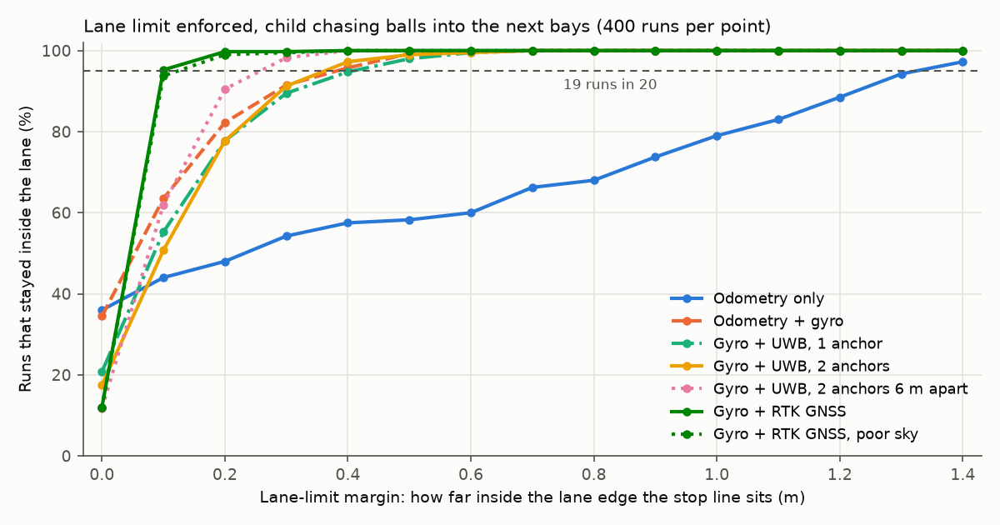
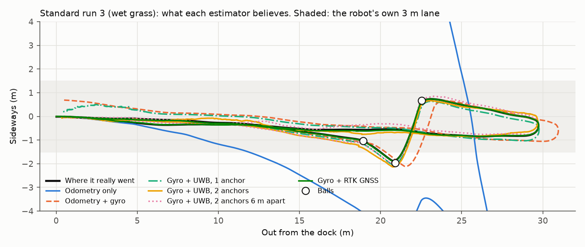

# Can Mulligan hold its lane? Simulation results

The question: can Mulligan stay in front of its own bay (3 m wide) out to 30 m, and what does
it need to know where it is? This is a simulation, not a measurement. Every number about grass,
the dock and the sensors is either cited or marked **assumed** below, and R0's test drives
should replace them. Full tables: [results/summary.md](results/summary.md). How to rerun it:
[README.md](README.md). Hardware, prices and licensing: the research note
[docs/research/positioning-lane-limit.md](../../docs/research/positioning-lane-limit.md).

## Answer

**Recommendation for R2:** fit **RTK GNSS** (a ZED-F9P on the robot, with AUSCORS corrections
over the range's Wi-Fi, or the range's own base station), fused with the gyro and encoders
in the EKF (`RtkEkf` in `mulligan_sim/estimators.py`). Set the lane-limit **margin to 0.4 m**
while the receiver has an RTK fix, and **0.6 m** when it hasn't had one recently. Keep
odometry plus gyro as the fallback through those gaps. Drop UWB: a fixed outdoor UWB beacon
isn't licensed in Australia.

| Estimator | Sideways error at 30 m, median / 1 run in 20 | Worst in a run, 1 run in 20 | Margin for the centre inside 19 in 20 | Margin for the whole robot inside 19 in 20 | In-lane balls reachable | Can it be used in Australia? |
| --- | ---: | ---: | ---: | ---: | ---: | --- |
| Odometry only | 2.22 / 8.46 m | 27.6 m | 1.4 m | 1.4 m | 5% | Yes, but useless |
| Odometry + gyro | 0.20 / 0.59 m | 1.12 m | 0.4 m | 0.6 m | 87% | Yes |
| Gyro + UWB, 1 anchor | 0.20 / 0.59 m | 0.97 m | 0.5 m | 0.7 m | 83% | **No**: fixed outdoor UWB beacon |
| Gyro + UWB, 2 anchors on the dock (2.8 m apart) | 0.15 / 0.45 m | 0.58 m | 0.4 m | 0.6 m | 94% | **No**, as above |
| Gyro + UWB, 2 anchors 6 m apart | 0.12 / 0.31 m | 0.40 m | 0.3 m | 0.5 m | 99% | **No**, as above |
| **Gyro + RTK GNSS** | **0.03 / 0.08 m** | **0.15 m** | **0.1 m** (0.2 m in a poor sky) | **0.4 m** (also in a poor sky) | **100%** | **Yes**: the receiver only listens |

Why:

1. **RTK is the only option that holds the lane with room to spare.** With a fix it is 8 cm
   off at 30 m one run in twenty, against 0.31–0.59 m for everything else. Under the lane
   limit it keeps the whole robot inside 19 runs in 20 with a 0.4 m margin, leaving 2.2 m of
   lane for its centre. A child can still reach every ball in the robot's own lane. A poor sky
   near nets and poles (assumed: four times the dropouts, three times the wrong fixes) moves
   the centre's margin from 0.1 to 0.2 m and leaves the whole-robot margin at 0.4 m.
2. **Its weak spots are the first metres and the gaps, and odometry plus gyro covers both.**
   The receiver has no fix under the bay roof and takes a few seconds to get one outside, so
   the first 5–10 m are dead-reckoned from the dock. That is where nearly all of RTK's margin
   is spent. One crossing traced in detail had 0.14 m of dead-reckoning error 8 m out,
   before the first fix. With no corrections at all (Wi-Fi or caster down), RTK is exactly odometry plus
   gyro (0.59 m at 30 m), which is why the margin should widen to 0.6 m without a fix.
3. **A wrong RTK fix is the risk to design for.** The model assumes 1% of fixes have the
   wrong integer ambiguity, 0.1–0.4 m out. A wrong fix that arrives straight after a float
   spell, when the filter is unsure, gets through the gate. Standard run 2 shows this: 0.34 m
   off at 30 m for about 30 s. The firmware should cross-check a new fix against the
   dead-reckoned position and the receiver's own accuracy estimate before trusting it, and
   R2 should measure how often wrong fixes happen at the range.
4. **Odometry plus gyro alone works only if the dock and the gyro are good.** It needs the
   dock to line the robot up to about half a degree. At 1.5° the error at 30 m reaches 1.6 m,
   and with three times the datasheet's drift and a 1% scale error the worst error in a run
   reaches 2.4 m. If R0 measures both as good, odometry plus gyro with a 0.6 m margin could
   carry a pilot on end bays while RTK is fitted. It is not a long-term answer.
5. **UWB is out on licensing, and wouldn't have been the best anyway.** Under the LIPD Class
   Licence 2025, clause 67(3), a UWB transmitter may not run from a fixed outdoor location, and
   an open-fronted bay is not "indoors" (research note, section 1). The UWB rows stay for
   reference. Fused with the gyro, two dock anchors did better than the research note's
   single-shot figure (0.45 m, one run in twenty, against its 1.42 m at 1 sd), but still five
   times worse than RTK.
6. **Odometry alone can't hold a lane.** A spin turn on grass ruins its heading: it is 8.5 m
   out at 30 m one run in twenty, and only reaches 19 in 20 inside by leaving a 0.2 m lane
   that blocks 95% of the balls.

**Cost** (research note, AUD inc GST): RTK is about 670 per robot with AUSCORS corrections.
An own base station adds about 690 per range, shared by every bay. Two UWB anchors and a tag
would have been about 155.

**About the two margins:** the simulation tested fixed margins only. The rule "0.4 m with a
recent fix, 0.6 m without" combines two tested cases: RTK at 0.4 m, and odometry plus gyro at
0.6 m. The switch between them is not simulated yet. All the margins also cover about 4 cm by
which the robot overshoots the stop line even with perfect sensing, from braking at creep speed
and the two sides ramping separately while it turns.

## Plots

RTK stays near 0.1 m all the way out and back. The gyro-only estimators keep growing on the way
home. Two UWB anchors shrink the error again near the dock, where their geometry is good.

## The ten standard runs

These are the ten 30 m out-and-back runs that R0 will also drive: seeds 0–9, alternately dry
and wet grass, with two or three pickups each, spin turns or arcs, and six balls in the
neighbouring bays. Sideways error at the furthest point out, in metres:

| Run | Grass | Odometry only | Odometry + gyro | UWB, 1 anchor | UWB, 2 anchors | UWB, 2 anchors 6 m apart | RTK |
| --- | --- | ---: | ---: | ---: | ---: | ---: | ---: |
| 0 | dry | -1.48 | +0.03 | +0.00 | +0.05 | +0.13 | +0.01 |
| 1 | wet | +3.87 | -0.24 | -0.26 | -0.18 | +0.17 | -0.02 |
| 2 | dry | +0.25 | -0.01 | +0.00 | -0.37 | +0.14 | -0.34 (wrong fix) |
| 3 | wet | -7.84 | -0.23 | -0.22 | +0.16 | +0.01 | -0.02 |
| 4 | dry | +2.12 | +0.04 | -0.02 | +0.13 | -0.30 | +0.00 |
| 5 | wet | +8.29 | -0.43 | -0.35 | -0.21 | -0.27 | +0.02 |
| 6 | dry | -1.96 | -0.44 | -0.45 | -0.01 | +0.33 | +0.00 |
| 7 | wet | -10.82 | -0.14 | -0.07 | -0.45 | -0.32 | -0.08 |
| 8 | dry | +1.28 | -0.03 | -0.01 | +0.03 | -0.00 | +0.04 |
| 9 | wet | +6.63 | +0.28 | +0.33 | -0.03 | -0.00 | +0.02 |

**Believing it's inside while it's outside** (no lane limit, 500 Monte-Carlo runs, 302 of
which left the lane):

| Estimator | Share of out-of-lane time believed inside | Runs fooled by more than 25 cm | 95th pct depth outside while believed inside |
| --- | ---: | ---: | ---: |
| Odometry only | 21% | 122 of 302 | 1.10 m |
| Odometry + gyro | 3.7% | 31 of 302 | 0.31 m |
| Gyro + UWB, 1 anchor | 4.7% | 38 of 302 | 0.34 m |
| Gyro + UWB, 2 anchors | 4.0% | 33 of 302 | 0.30 m |
| Gyro + UWB, 2 anchors 6 m apart | 2.8% | 9 of 302 | 0.22 m |
| Gyro + RTK GNSS | 1.0% | 0 of 302 | 0.06 m |

In the ten standard runs, odometry alone believed it was inside for 46% of the time it was
actually outside. Every other estimator did so for 6% or less, and RTK for 3%.

## Sensitivity

95th percentile sideways error at 30 m / worst at any time in the run, in metres, over 300 runs
each:

| Case | Odometry + gyro | UWB, 1 anchor | UWB, 2 anchors | UWB, 2 anchors 6 m apart | RTK |
| --- | ---: | ---: | ---: | ---: | ---: |
| Baseline | 0.59 / 1.10 | 0.60 / 0.96 | 0.44 / 0.59 | 0.30 / 0.40 | 0.08 / 0.16 |
| Gyro 3x drift, 1% scale error | 0.84 / 2.40 | 0.88 / 1.68 | 0.51 / 0.73 | 0.33 / 0.51 | 0.08 / 0.17 |
| Dock heading 1.5° (1 sd) | 1.61 / 1.63 | 1.55 / 1.56 | 0.51 / 0.64 | 0.31 / 0.40 | 0.08 / 0.43 |
| UWB 15 cm noise, 5% outliers | 0.59 / 1.10 | 0.60 / 1.03 | 0.47 / 0.64 | 0.35 / 0.43 | 0.08 / 0.16 |
| All wet grass | 0.61 / 1.05 | 0.59 / 0.97 | 0.43 / 0.57 | 0.32 / 0.40 | 0.08 / 0.19 |
| RTK: poor sky (nets, poles) | | | | | 0.10 / 0.23 |
| RTK: slow first fix, 20–40 s | | | | | 0.08 / 0.41 |
| RTK: no corrections | | | | | 0.59 / 1.10 |

The RTK-only cases change nothing for the other estimators, so their cells are left blank. For
RTK, the worst error in a run comes from the dead-reckoned stretch before the first fix. That
is why a poor dock alignment or a slow first fix shows up in the worst case (0.41–0.43 m) but
not at 30 m. The margin study ran at the baseline and for RTK in a poor sky. If R0 or the
pilot range measures nearer the bad rows, rerun it.

## What was modelled, and the assumptions

| Item | Value | Source |
| --- | --- | --- |
| Wheels, track, wheelbase, encoders, speed and acceleration limits | 144 mm, 370 mm, 240 mm, 28 counts × 26.9 = 753.2 per wheel turn, 4 km/h, 1.0 / 2.5 m/s² | `robot/design/params.mjs` |
| Gyro residual bias after dock calibration | 0.5°/min, 1 sd | CEVA BNO08X datasheet 1000-3927 v1.17, §6.7, Fig. 6-14: game rotation vector dynamic heading drift 0.5°/min. Read as 1 sd; the datasheet doesn't say whether typical or maximum. |
| Gyro white noise | 0.014 °/s/√Hz | **Assumed**: Bosch's figure for its BMI085/BMG160-class gyros. The BNO08X datasheet only points to the BMF055 for its sensors. |
| Gyro bias walk, scale error | 0.0003 °/s/√s; 0.5% (1 sd) | **Assumed**: the datasheet gives neither. The scale error also absorbs tilt on uneven grass. |
| Dock zeroing | 2 cm, 0.5° (1 sd) | **Assumed**. This is the number that matters most for odometry plus gyro, and for RTK before its first fix. |
| Skid-steer turn scrub, χ = effective track / track | dry 1.45 ± 0.05, wet 1.60 ± 0.10, varying along the run | **Assumed**: typical for this track-to-wheelbase ratio |
| Longitudinal slip | dry 2%, wet 5%, rising 4–8% per rad/s of turn; left/right difference 0.2–0.6% | **Assumed** |
| Sideslip in turns, yaw kicks from tussocks | 0.02–0.04 s × v·ω; 0.010–0.015 rad/s, 0.3 s correlation | **Assumed** |
| RTK fixed accuracy | 1 cm white + 1.5 cm slow multipath per axis (about 2 cm) | Research note §3: ZED-F9P 0.010 m horizontal; "~1–2 cm when fixed". Split into white and slow: **assumed**. |
| RTK float | 0.4 m slow (15 s) + 0.1 m white per axis | Research note §3: "0.2–1 m". Shape **assumed**. |
| RTK under the roof and first fix | no solution for x < 1 m; float for 3–10 s after rolling out | Research note §3: no fix under the roof, "under 10 s" for the F9P. Roof depth **assumed**. |
| RTK dropouts | one float spell every 2 min in the open, every 15 s within 4 m of the roof edge, each 2–8 s | **Assumed**. The note says multipath near the roof, net poles and fences is unknown until measured. |
| RTK wrong fixes | 1% of fixes, 0.1–0.4 m out, until the next float spell or 30 s | **Assumed** |
| RTK rate, lane survey | 5 Hz, no latency; lane surveyed to 2 cm and 0.05° | **Assumed**; the note proposes surveying by driving to the lane corners |
| RTK poor-sky case | four times the dropouts, 4–15 s each, 3% wrong fixes | **Assumed** |
| UWB | 8 cm white plus 5 cm slow error per anchor (about ±10 cm in all), 2% long multipath outliers of 0.3–2.5 m, 5% dropouts, 10 Hz | **Assumed**, from the brief's "about ±10 cm" |
| UWB anchors | one at the dock's centre; two at the bay's front corners (2.8 m apart); or two on the neighbouring dividers (6 m apart); all 0.3 m behind the parked robot, at antenna height | **Assumed** layouts. Not licensable outdoors in Australia (research note §1). |
| Lane-limit rule | stop line at 1.5 m minus the margin (and 30 m minus the margin); a 0.6 m slow zone before it, with outward speed falling to 0.25 m/s at the line; turns and inward motion always obeyed | Design choice, `mulligan_sim/lane_limit.py` |
| Driver | steers on the true pose (a child watches the robot), wobbles, spins or arcs, gives up on a ball after 6 s without progress | **Assumed** |
| Scenarios | 30 m out and back, 2–3 pickups out, 0–1 on the way home; the margin study chases 60% of balls 2–3.5 m into the neighbouring bays | **Assumed** |

Further modelling choices:

- The world is flat and 2D. Slopes and bumps appear only as gyro scale error and yaw kicks.
- "Inside" is judged on the robot's centre. The body reaches a further 0.21 m (half the track
  plus half a wheel), so a "whole robot inside" column is given too.
- Both EKFs share five states: position, heading, gyro bias and odometry distance scale. Gyro
  bias is barely observable in a two-minute run, so they correct heading through position
  rather than by learning the bias.
- The RTK filter uses only fixed positions, as the research note's firmware rule says, with a
  99.9% two-degree-of-freedom gate. After 5 s of rejected fixes it lets one through with a
  10 cm variance.
- The UWB filter uses a 3-sigma gate on each range. The EKF's noise settings were swept, and
  the two-dock-anchor result moved only between 0.37 and 0.40 m: the anchors' geometry limits
  it, not the tuning.

## What R0 and R2 should do with this

- **Measure on R0:** the dock's heading repeatability (it matters for every option), the gyro's
  scale error (spin the robot ten turns on the dock against a mark), heading drift over a
  2-minute out-and-back, and the turn scrub χ and slip on dry and wet grass. Put them in
  `mulligan_sim/world.py`, `sensors.py` and `scenarios.py`, then rerun the study.
- **Measure at the pilot range before buying RTK** (research note, "What to measure"): the
  distance to the nearest AUSCORS mountpoint, Wi-Fi out to 30 m, and the sky in front of the
  bays. Once a receiver is fitted, measure the time to a fix after leaving the roof, the share
  of fixed against float along the lane, and any wrong fixes. Replace the assumed RTK numbers
  in `GnssSpec`.
- **Firmware:** port `estimators.py` (`OdometryGyro` for R0, `RtkEkf` for R2) and
  `lane_limit.py`. Use only fixed positions. Cross-check each new fix against the
  dead-reckoned position before trusting it. Use the 0.4 m margin with a recent fix and 0.6 m
  without. Turn off the BNO085's dynamic gyro calibration while driving and re-zero the bias
  whenever the robot sits still on the dock.
- **Next in this simulation:** simulate the two-level margin and a fix cross-check, then size
  the "recent fix" window.
- **For a pilot:** the plan's end bays, or an empty bay either side, remain sensible until RTK
  has been measured at the range.
